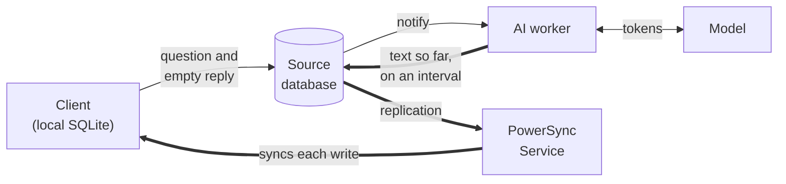
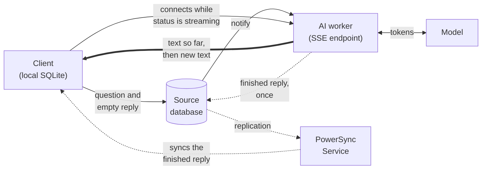

In an AI chat, the assistant's reply appears a few words at a time while the model generates it. With PowerSync, each reply is a row in a synced table. A worker on your backend calls the model and writes the reply to that row in your backend database, which PowerSync calls the **source database**. The PowerSync Service, the server between your source database and your clients, syncs the row to each client's local SQLite database like any other data. The client never calls the model, so model API keys stay on your server.

While the worker generates a reply, its text can reach clients in two ways:

- **Streaming through the database**: the worker writes the text generated so far to the reply's row on an interval. PowerSync syncs each write.
- **Streaming over a separate connection**: the worker sends new text to clients over a connection that does not go through the database. It writes the finished reply to the row once.

Both approaches use the same tables and the same [Sync Streams](/sync/streams/overview), which define the data that each client syncs. In both approaches, the worker saves the finished reply in the same synced row. The client can also smooth the text, so that the reply appears at a steady pace instead of in steps. The [AI chat demo](#example-implementation) shows both approaches in a React and Supabase app.

## Replies as Synced Data

Because each reply is a synced row, your chat gets the following behavior:

- If the user refreshes the page during a reply, the worker continues to generate it. The client shows the text generated so far and continues to receive new text.
- The reply appears in every tab and on every device that has the chat open.
- A question asked offline waits in the [upload queue](/client-sdks/writing-data#write-operations-and-upload-queue). The worker answers it after the client reconnects and uploads it.
- Synced chats and messages are in the local SQLite database, so the app reads them without a network request and shows them while offline.

## Syncing Chats and Messages

A chat app can sync its data with two Sync Streams:

```yaml
config:
  edition: 3

streams:
  chats:
    auto_subscribe: true
    query: SELECT * FROM chats WHERE user_id = auth.user_id()

  chat_messages:
    query: |
      SELECT * FROM messages
      WHERE chat_id = subscription.parameter('chat_id')
        AND user_id = auth.user_id()
```

The `chats` stream syncs the user's chat list whenever the client connects. The client subscribes to `chat_messages` with a chat's ID while that chat is open. See [Client-Side Usage](/sync/streams/client-usage) for how to subscribe in each SDK. Both streams filter on [`auth.user_id()`](/sync/streams/parameters#auth-parameters), the signed-in user's ID, so each user syncs only their own chats and messages.

## How a Reply Is Generated

Both approaches share this flow:

1. The client writes two rows to its local SQLite database in one transaction: the user's message, and an empty assistant message with the status `pending`. The client SDK queues both rows in the upload queue and passes them to your `uploadData()` function. That function writes them to your source database, for example through your backend API, or directly with the Supabase client library as the demo does.
2. Your backend notifies an AI worker that a reply is pending. See [Notifying the Worker](#notifying-the-worker).
3. The worker claims the reply with an update that changes its status from `pending` to `streaming`. The update only matches while the status is still `pending`. If several workers receive the notification, only one update matches, so only one worker generates the reply.
4. The worker calls the model, which streams the reply as tokens: small pieces of text, often parts of words. The text reaches the client while the model generates it. The two approaches differ mainly in this step and in how the worker notices that the user stopped the reply.
5. The worker saves the finished text in the row and sets the status to `done`. PowerSync syncs the row to every client subscribed to the chat.

The empty assistant message is the row that the worker fills. Because the client creates it locally, the UI shows the pending reply at once, even offline. The user can also stop the reply before a worker starts.

The status column tells every client what state the reply is in:

| Status | Meaning | Set by |
| --- | --- | --- |
| `pending` | The reply waits for a worker. | The client, for a new question or a retry. The worker, for a reply interrupted by a restart. |
| `streaming` | A worker is generating the reply. | The worker |
| `done` | The reply is finished. | The worker |
| `stopped` | The user stopped the reply. | The client |
| `error` | Generation failed. The row holds the error message. | The worker |

To stop a reply, the client sets its status to `stopped`. To retry, the client clears the text and sets the status back to `pending`, which notifies a worker in the same way as a new question. How the worker notices a stop depends on the approach.

### Notifying the Worker

With Postgres, the database can notify the worker. A trigger, which is a function that the database runs when a row changes, calls `pg_notify()` when an assistant message is saved with the status `pending`. The worker keeps a database connection open and receives the notification with `LISTEN`. With another [source database](/configuration/source-db/setup), your backend API can notify the worker when it saves the pending message.

Postgres does not keep a notification for a worker that is down. When the worker starts, it also looks for replies that are still `pending`. It also resets replies that a crashed worker left in `streaming` back to `pending`, so that they are generated again from the beginning. With several workers, record which worker owns each reply, so that a starting worker does not reset replies that another worker is still generating.

## Streaming Through the Database

In this approach, the worker writes the text generated so far to the reply's row while the model generates it. Each write is an ordinary row update. The Service reads the update from your source database through [replication](/architecture/powersync-service#replication-from-the-source-database) and syncs it to every client subscribed to the chat. On the client, a [watched query](/client-sdks/watch-queries) reads the messages. A watched query runs again when its data changes, as `useQuery` does in React. After each synced write, the UI shows the longer text.

In this diagram, thick arrows carry the text while the worker generates the reply:



The worker collects tokens in memory and, on an interval, writes all the text generated so far as one update. The interval caps the write rate. With an interval of 100 ms, the worker writes a reply at most 10 times per second, however fast the model produces tokens. The demo uses that interval. The last write sets the status to `done`.

To notice a stop, the worker includes the status in the condition of each write:

```sql
UPDATE messages
SET content = $1, status = $2
WHERE id = $3 AND status = 'streaming'
```

When the user stops the reply, the client sets the status to `stopped`. After that change reaches the source database, the worker's next write matches no row, and the worker cancels the model request. You do not need a separate stop signal.

This approach has these benefits:

- PowerSync is the only channel to the client. You do not build or secure an extra endpoint. The client SDK resumes syncing on its own after a connection drops.
- The partial text is in the row. A client that opens the chat or reconnects during a reply catches up through normal sync. It shows the text so far, then each later write.
- Clients never connect to a worker, so any worker can generate any reply.

It has these costs:

- Each write syncs the whole row, including all the text generated so far. A long reply sends its early text again with every write. Each write goes to every client subscribed to the chat. With very long replies or many clients subscribed to a chat, the synced data adds up. On PowerSync Cloud, [data synced](/resources/usage-and-billing/usage-and-billing-faq) is a billed usage metric.
- Each write is also an update in your source database. The Service keeps each write in its [operation history](/architecture/powersync-service#operation-history), a log of row changes that it uses to sync clients. Until [compacting](/maintenance-ops/compacting-buckets) runs, a client that syncs the chat for the first time downloads every earlier write of each reply, not only the latest text. Compacting removes the data of outdated writes. PowerSync Cloud compacts once per day.
- The interval is a trade-off. A shorter interval gives smaller steps and shows text sooner, but causes more writes. A longer interval causes fewer writes, but each step is bigger. [Text smoothing](#smoothing-the-displayed-text) makes the steps less visible.

## Streaming Over a Separate Connection

In this approach, the worker sends the text to clients over a separate connection while the model generates it. The worker writes the row only once, when the reply is finished. This section uses **Server-Sent Events (SSE)** for the connection. SSE is an HTTP response that stays open so that the server can send events as they happen.

In this diagram, thick arrows carry the text while the worker generates the reply. Dotted arrows carry the finished reply once:



The worker keeps each reply's text in memory and serves it from an SSE endpoint:

- The synced row still tells clients when to connect. Each client opens a connection for every reply whose synced status is `streaming`, so other tabs and devices stream the reply too.
- Each connection first receives all the text generated so far, then new text as it arrives. A client that connects late or reconnects catches up this way.
- The endpoint serves a reply only to the user who owns it. For example, the client sends its access token in an `Authorization` header, and the endpoint checks the token before it streams. If you send the token in a header, read the stream with `fetch()`. The browser's built-in SSE client, `EventSource`, cannot set request headers.
- When the reply is finished, the worker writes the full text and the `done` status to the row in one update, then closes the SSE connections. Keep showing the streamed text until that update syncs. The update carries the text and the status together, so the UI switches from the streamed text to the synced row without a gap.

The worker does not write the row during generation, so it cannot detect a stop from an update that matches no row. Your backend has to notify the worker instead. For example, a second trigger can notify the worker when a reply's status changes to `stopped`. The worker then cancels the model request and saves the text generated so far.

This approach has these benefits:

- The worker writes the reply text to the database once, whatever its length. The token stream stays out of your source database. With many replies generated at the same time, the database receives one text write per reply instead of one per interval.
- Each SSE event carries only the new text, not all the text generated so far.
- Clients receive text as soon as the worker receives it from the model, without waiting for a write interval, replication, or sync.
- The finished reply is still a synced row, so chat history, multiple devices, and offline questions work as they do when you stream through the database.

It has these costs:

- During generation, the text exists only in the worker's memory. If the worker restarts, that text is lost. A client that opens the chat then sees an empty reply until a worker generates it again. When you stream through the database, an interrupted reply also starts over, but the text so far stays in the row while the worker is down.
- With several workers, each client must reach the worker that generates its reply. This requires routing each client's connection to the worker that claimed the reply, for example by recording that worker in the row. Services such as Cloudflare Durable Objects address this problem: each object has a unique name, so clients can send requests to the object that generates a specific reply.
- You build and run more parts: the endpoint, its authentication, the client's reconnect logic, and the stop notification.

## Smoothing the Displayed Text

Text reaches the client in steps. When you stream through the database, each step is one synced write: about one per write interval, plus sync time. When you stream over a separate connection, each step is one SSE event. Some models, Gemini included, also send text in a few large chunks. If the UI renders each step when it arrives, the reply jumps forward and then pauses.

To avoid these jumps and pauses, separate the text that the UI shows from the text that the client has received. The received text comes from the synced row or the SSE connection. The UI shows the start of the received text and reveals the rest a few characters per animation frame at a steady pace. Smoothing runs only on the client. It does not change what the worker writes or what PowerSync syncs, so you can tune it or remove it without changing the backend.

To keep the pace steady, a smoother can do the following:

- Measure the average time between arrivals, and spread each arrival over that time. The text keeps moving until the next arrival is due, instead of jumping ahead and then waiting.
- Change speed gradually, so that the pace does not jump when arrivals speed up or slow down.
- Cap the pace. Go faster than the cap only when the displayed text falls too far behind the received text.
- Show text that is already present when a message first renders, such as chat history, immediately and without animation.

The demo's `useSmoothText` React hook works this way. It caps the pace at about 150 characters per second. It spreads each arrival over at most 1 second, so that a long pause in the stream does not slow the text that follows.

The cost is delay. When the model sends text faster than the pace cap, the displayed text can trail the received text by a few seconds.

When you stream through the database, smoothing changes what the write interval controls. Without smoothing, a longer interval shows as bigger jumps. With smoothing, the reply keeps moving between writes, so a longer interval mainly adds delay. You can then choose the interval for write volume, as long as writes are closer together than the longest time that the smoother spreads an arrival over.

## Choosing an Approach

|  | Streaming through the database | Streaming over a separate connection |
| --- | --- | --- |
| Path of the text during generation | Worker → source database → PowerSync Service → client | Worker → SSE connection → client |
| Where the partial text lives | In the reply's row | In the worker's memory |
| Text writes to the database per reply | One per write interval during generation | One, when the reply finishes |
| Data a client receives per update | All the text generated so far | Only the new text |
| When new text reaches the client | After the next write, replication, and sync | As soon as the worker receives it from the model |
| Running several workers | Any worker can generate any reply | Each client must reach the worker that generates its reply |
| Parts to build beyond the worker | None | An SSE endpoint with authentication, client reconnect logic, and a stop notification |

If you are not sure which approach to use, start with streaming through the database. It has fewer parts. PowerSync delivers each write, including to clients that reconnect or open the chat during a reply.

If the write load on your source database or the data synced to clients grows too large, consider a separate connection. Long replies and many replies generated at the same time increase both the write load and the synced data. Many clients subscribed to the same chat increase the synced data. Both approaches use the same tables, client writes, and Sync Streams, so switching later does not change your data model.

## Example Implementation

The [AI chat demo](https://github.com/powersync-ja/powersync-js/tree/main/demos/react-supabase-ai-chat) {/* TODO: Verify the demo link after the react-supabase-ai-chat demo merges to main */} implements both approaches and text smoothing. It uses React, Supabase (Postgres with anonymous sign-in), the PowerSync Web SDK, Sync Streams, and a Node.js AI worker that calls the model with the [Vercel AI SDK](https://ai-sdk.dev). One setting switches between the two approaches. Another setting turns smoothing off, so you can see the steps as they arrive.

The demo implements each concept in these files:

- Sending, stopping, and retrying a reply: `src/library/chat.ts`
- Claiming replies and restarting interrupted ones: `worker/index.ts`
- The tables and the triggers that notify the worker: `supabase/migrations/`
- Sync Streams: `powersync/sync-config.yaml`
- Streaming through the database: `worker/stream-postgres.ts`
- Streaming over a separate connection: `worker/stream-sse.ts` and `src/components/chat/useSseReply.ts`
- Text smoothing: `src/components/chat/useSmoothText.ts`

To set up PowerSync with Supabase for your own app, see the [Supabase integration guide](/integrations/supabase/guide).
