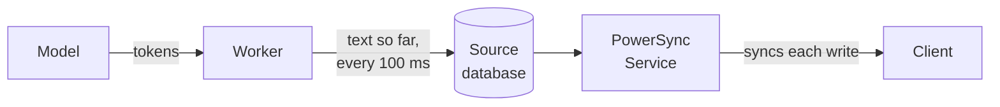
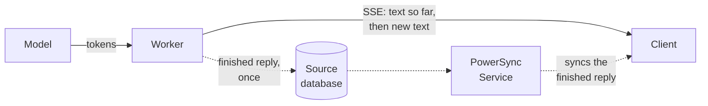

With PowerSync, each AI chat reply is a row in a synced table. A **worker** on your server calls the model and writes the reply to that row in your source database. PowerSync then syncs the row to clients like any other data. The client never calls the model, so model API keys stay on your server.

The worker is whatever generates replies. It can be your backend API, a separate worker process, or a background job.

Since replies are ordinary synced data:

- A page refresh during a reply picks up where it left off.
- The reply appears in every tab and on every device that has the chat open.
- A question asked offline waits in the [upload queue](/client-sdks/writing-data#write-operations-and-upload-queue) and is answered when the client reconnects.
- Chat history is in the local database, so it loads without a network request.

While the model generates a reply, the text can reach clients through the database or over a separate connection. This page covers both.

## Data Model

You need a `chats` table and a `messages` table. Each assistant message has a `status` column that tells clients what state the reply is in:

| Status | Meaning |
| --- | --- |
| `pending` | Waiting for a worker |
| `streaming` | Being generated |
| `done` | Finished |
| `stopped` | Stopped by the user |
| `error` | Generation failed. The row holds the error message. |

Two [Sync Streams](/sync/streams/overview) sync the data. The `chats` stream syncs the user's chat list, and the client subscribes to `chat_messages` for the chat that is open:

```yaml
config:
  edition: 3

streams:
  chats:
    auto_subscribe: true
    query: SELECT * FROM chats WHERE user_id = auth.user_id()

  chat_messages:
    query: |
      SELECT * FROM messages
      WHERE chat_id = subscription.parameter('chat_id')
        AND user_id = auth.user_id()
```

See [Client-Side Usage](/sync/streams/client-usage) for how to subscribe in each SDK.

## Generating a Reply

1. When the user sends a message, the client writes it and an empty assistant message with the status `pending` in one local transaction. The UI shows the pending reply right away, even offline.
2. The client SDK uploads both rows to your backend through the `uploadData()` function in your [backend connector](/configuration/app-backend/client-side-integration).
3. A worker picks up the pending reply and changes its status to `streaming`. Make this update conditional on the status still being `pending`, so that only one worker generates each reply.
4. The worker sends the chat history to the model and streams the reply to clients with one of the approaches below.
5. When the model finishes, the worker saves the full text and sets the status to `done`.

Stop and retry are client writes too. Stop sets the status to `stopped`. Retry clears the text and sets the status back to `pending`, so the reply goes through the same steps as a new one.

How the worker hears about new and stopped replies depends on what it is. If your backend API is the worker, it already sees these changes when it applies the upload, so it can start or cancel the reply right there. A separate worker needs a notification. With Postgres, a trigger can call `pg_notify()` when a reply changes.

When a worker starts, it should also pick up replies that were left `pending` or `streaming` while it was down.

## Streaming Through the Database

The worker writes the text generated so far to the reply's row on a fixed interval, such as every 100 ms. Each write is a normal update, so PowerSync syncs it and a [watched query](/client-sdks/watch-queries) re-renders the message.



The interval caps the write rate however fast the model produces tokens. Include `status = 'streaming'` in each update's condition, so that a write never overwrites a stop.

This is the simpler approach. PowerSync is the only channel to the client, clients that reconnect or open the chat mid-reply catch up through normal sync, and any worker can generate any reply.

The downside is data volume. Each write syncs the whole row, so a long reply sends its early text again with every write, to every client subscribed to the chat. The Service also keeps each write in its [operation history](/architecture/powersync-service#operation-history) until [compacting](/maintenance-ops/compacting-buckets) runs. On PowerSync Cloud, [data synced](/resources/usage-and-billing/usage-and-billing-faq) is a billed metric.

## Streaming Over a Separate Connection

The worker keeps the reply in memory while it generates and sends the text to clients over a separate connection, such as Server-Sent Events (SSE). It writes the reply to the database once, when it is finished.



The synced status still tells the client when to connect. While a reply is `streaming`, the client connects to the worker, receives the text so far, and then receives new text as it arrives. If the connection drops, the client reconnects until the status changes. When the finished reply syncs, the client shows the row instead of the streamed text. Authenticate the connection so that users can only read their own replies.

This keeps the token stream out of your database. Each reply is one text write regardless of its length, each event carries only new text, and clients get text without waiting for a write interval or sync.

In exchange, there are more parts to build: an authenticated endpoint on the worker and reconnect logic on the client. The partial text exists only in the worker's memory, so a restart loses it and the reply starts over. With several workers, each client has to reach the worker that is generating its reply. Services such as Cloudflare Durable Objects solve this routing problem.

## Smoothing the Text

In both approaches, text arrives in steps: one synced write or one SSE event at a time. Some models also send text in a few large chunks. If the UI renders each step as it arrives, the reply jumps and pauses.

To fix this, keep the received text separate from the displayed text, and reveal the difference a few characters per animation frame. Set the pace from how often text arrives, and show existing messages such as chat history without animation. The displayed text then trails the received text slightly.

The worker can also pace the text before sending it, which evens out models that send large chunks. The reply then finishes after the model does, and streaming through the database takes more writes. Smoothing on the client is still useful, because sync and the network add their own uneven delays.

## Choosing an Approach

Start with streaming through the database. It has fewer parts, and PowerSync handles delivery and reconnects. Consider a separate connection when the write load on your database or the data synced to clients grows too large. Long replies, many replies at once, and many clients per chat all add to both.

Both approaches use the same tables, Sync Streams, and client writes, so you can switch later without changing your data model.

## Example Implementation

The [AI chat demo](https://github.com/powersync-ja/powersync-js/tree/main/demos/react-ai-chat) {/* TODO: Verify the demo link after the react-ai-chat demo merges to main */} implements both approaches in a React app with Postgres. Its Node.js backend API is the worker: it applies uploads and calls the model with the [Vercel AI SDK](https://ai-sdk.dev). One setting switches between the approaches, and smoothing and pacing can each be turned off to see the raw steps. Without a model API key, the worker simulates replies. The demo's README covers running it locally.

To build a backend API for your own app, see [App Backend Setup](/configuration/app-backend/setup).
