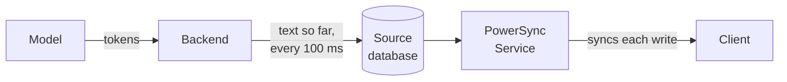
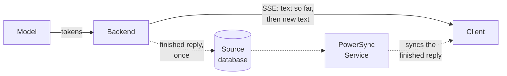

With PowerSync, an AI chat can be stored as ordinary synced rows. Your backend calls the model and writes each reply to your source database, and PowerSync syncs it to the client. Chat history then works offline, and the same chat shows on every device.

Showing a reply while the model is still generating it builds on this, and is covered in the [second half](#streaming-replies-while-the-model-generates-them) of this guide.

## Storing Chats as Synced Data

Your backend calls the model, never the client, so model API keys stay on your server. The code that calls the model can live in your backend API, a separate process, or a background job, as long as it can write to your source database.

Because the client reads and writes only to its local database:

- A chat opens without a network request.
- A reply in progress survives a page refresh, and shows in every tab and device where the chat is open.
- A message sent offline waits in the [upload queue](/client-sdks/writing-data#write-operations-and-upload-queue) until the client reconnects.
- If several users can access a chat, for example through a chat members table in your Sync Streams, they all see new messages and replies as they arrive.

### Tables

Create a `chats` table and a `messages` table. Give assistant messages a `status` column so that the client can show whether a reply is pending, being generated, done, stopped, or failed. If generation fails, store the error message on the row as well.

### Sync Streams

Define two [Sync Streams](/sync/streams/overview). The `chats` stream syncs the user's chats, and the client subscribes to `chat_messages` for the chat that is open:

```yaml
config:
  edition: 3

streams:
  chats:
    auto_subscribe: true
    query: SELECT * FROM chats WHERE user_id = auth.user_id()

  chat_messages:
    query: |
      SELECT * FROM messages
      WHERE chat_id = subscription.parameter('chat_id')
        AND user_id = auth.user_id()
```

See [Client-Side Usage](/sync/streams/client-usage) for how to subscribe in each SDK.

### Generating Replies

1. When the user sends a message, the client writes two rows in one local transaction: the user's message, and an empty assistant message with a pending status. The UI shows the pending reply right away, even offline.
2. The client SDK uploads both rows to your backend through `uploadData()` in your [backend connector](/configuration/app-backend/client-side-integration).
3. The backend claims the pending reply with a conditional update, so that only one backend instance works on it.
4. The backend sends the chat history to the model.
5. When the model finishes, the backend saves the full text and marks the reply as done.

The client receives each reply when the write from step 5 syncs.

## Streaming Replies While the Model Generates Them

To show reply text before the reply is complete, the backend has to send partial text to the client during step 4. We have built and tested two ways to do this, and the [demo](#example-implementation) implements both.

### Streaming Through the Database

The backend writes the text it has so far into the reply's row at a fixed interval, for example every 100 ms. PowerSync syncs each update, and a [watch query](/client-sdks/watch-queries) on the client re-renders the message. The interval keeps the write rate steady no matter how fast the model produces tokens.



This is the simpler of the two, because PowerSync is the only channel to the client. A client that opens the chat mid-reply catches up through normal sync.

The downside is volume. Each write is an update in your source database, and it syncs the whole row, so a long reply sends its earlier text again with every write, to every client subscribed to the chat.

### Streaming Over a Separate Connection

The backend keeps the reply in memory and sends the text to clients over a separate connection, for example Server-Sent Events (SSE). It writes the row once, when the reply is finished.



When a reply is being generated, the client opens a connection to the backend and shows the text as it arrives. If the connection drops, it opens it again. When the finished reply syncs through PowerSync, the client shows the row and closes the connection.

Each reply is written to your database once, however long it is. On the other hand, you have to build and secure the streaming endpoint yourself, and the partial text only exists in the backend's memory, so a restart means the reply starts over. If you run more than one backend instance, each client also has to connect to the instance that is generating its reply. Cloudflare Durable Objects and similar services solve that.

### Smoothing the Text

With either option, text arrives in steps, and some models send it in large chunks. If the UI renders each step as it arrives, the reply jumps and pauses. Keep the received text separate from the displayed text, and reveal the difference a few characters per animation frame, at a speed based on how often text arrives. Show existing messages without animation.

## Example Implementation

The [AI chat demo](https://github.com/powersync-ja/powersync-js/tree/main/demos/react-ai-chat) implements both options in a React app with Postgres. Its Node.js backend applies uploads and calls the model with the [Vercel AI SDK](https://ai-sdk.dev).

To build a backend API for your own app, see [App Backend Setup](/configuration/app-backend/setup).
