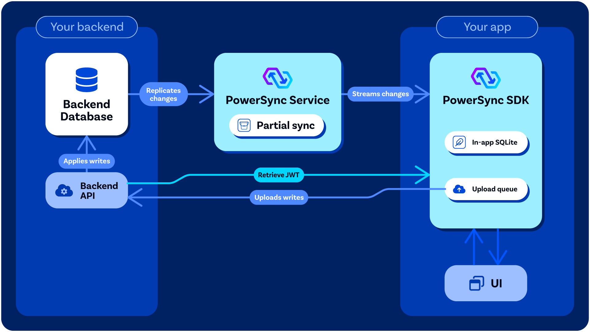

PowerSync generally assumes that you have some kind of "backend application" as part of your overall application architecture — whether it's a backend-as-a-service (e.g. Supabase), a custom backend (e.g. Node.js, Rails, Laravel, Django, ASP.NET), some kind of serverless cloud functions (e.g. Azure Functions, AWS Lambda, Google Cloud Functions, Cloudflare Workers, etc.), or any other equivalent system that allows you to run privileged logic securely.

PowerSync relies on that backend for up to two jobs: applying the mutations that clients upload, and, if you use custom authentication, generating the JWTs that clients use to connect to the PowerSync Service.

<Frame caption="An overview of how PowerSync interacts with your backend application / API.">
  
</Frame>

### Processing Mutations From Clients

When your app writes to its local SQLite database, the client SDK places the mutations in an [upload queue](/architecture/client-architecture#writing-data-via-sqlite-database-and-upload-queue). It uploads them by calling the `uploadData()` function in your [backend connector](/configuration/app-backend/client-side-integration), which sends them to your write API. Your write API applies them to your source database (Postgres, MongoDB, MySQL, SQL Server, or Convex). This design keeps server-side validation and authorization of mutations under your control, while PowerSync itself requires minimal permissions.

[Write Path Overview](/handling-writes/write-path/overview) explains how this works. To pick a setup, see [Choosing Your Implementation](/handling-writes/write-path/choosing-your-implementation).

### Authentication (Optional)

Some authentication providers already generate JWTs for users which PowerSync can work with directly — see [Authentication Setup](/configuration/auth/overview).

For others, some backend code/logic must be added to your backend application to generate the JWTs needed for PowerSync — see [Custom Authentication](/configuration/auth/custom).

In your [client-side](/configuration/app-backend/client-side-integration) _backend connector_ implementation, you need to define the `fetchCredentials()` function so that it returns a JWT which can be used by PowerSync Client SDK to authenticate with the [PowerSync Service](/architecture/powersync-service).

## Backend Options

If you already have some kind of backend application as part of your stack, it's best to use that existing backend. See [Use Your Existing API](/handling-writes/write-path/existing-api). Otherwise, there are several options for what you can use: (this is not an exhaustive list)

### Reference Write Implementation

If you don't have a write API yet, you can run the [reference write implementation](/handling-writes/write-path/reference-write-implementation). It's a Node.js write API for Postgres, MongoDB, MySQL, and SQL Server, and it comes with a TypeScript backend connector for your app.

### Custom Backend

To build a write API in your own backend stack, see [Build Your Own Write API](/handling-writes/write-path/build-your-own-write-api). Our [Example Projects](/intro/examples#backend-examples) page provides example custom backends (e.g. Node.js, Django, Rails, .NET, etc.)

### Backend-as-a-Service / Developer Platforms

There are several backend-as-a-service developer platforms that work well with PowerSync, for example:

- **Supabase** (for Postgres): Several of our demo apps demonstrate how to use [Supabase](https://supabase.com/) as the Postgres-based backend. Supabase provides both an authentication service, PostgREST data APIs, and edge functions for more custom logic. See our [integration guide](/integrations/supabase/guide). To apply mutations, choose between the [PostgREST route](/handling-writes/write-path/supabase-postgrest) and the [Edge Function route](/handling-writes/write-path/supabase-edge-function).
- **Neon** (for Postgres): Similarly to Supabase, [Neon](http://neon.tech/) provides PostgREST data APIs and an authentication service. See our [integration guide](/integrations/neon).

### Serverless Functions

You can use a serverless functions system like Azure Functions, AWS Lambda, Google Cloud Functions, Cloudflare Workers, Vercel Functions, Netlify Functions, Fastly Compute, Deno Deploy, etc.

### Data API Services

If you will only use the backend for applying mutations and not for authentication, you can also use some kind of data API service or API platform (e.g. Hasura).
