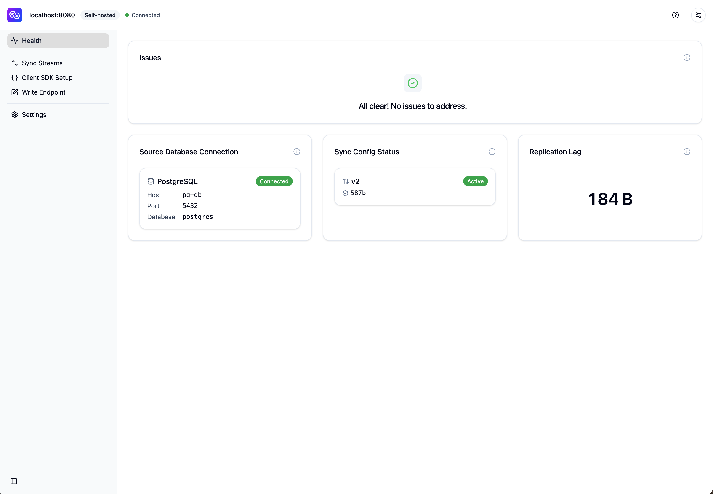

import SelfHostedDashboardCompose from '/snippets/self-hosted-dashboard-compose.mdx';

The Self-Hosted Dashboard runs as a Docker container next to your PowerSync Service. Each dashboard connects to one Service instance.

## What It Provides

- **Health:** See whether the Service reports errors or warnings, whether it can connect to your source database, whether replication is running, and which Sync Config version is active or deploying.
- **Sync Streams:** Edit a draft of your Sync Config, validate it, and compare it with the deployed version. To decide whether to deploy from the editor or export the YAML, see [Sync Config Management](#sync-config-management).
- **Client SDK Setup:** Generate the schema and connector code for your client framework.
- **Write Endpoint:** Follow a guide with reference code to [build your write endpoint](/handling-writes/write-path/build-your-own-write-endpoint).
- **Settings:** Reprocess, which replicates all data from your source database again. All clients then download their data again. Use it to clear a large history of changes that compacting can't remove, as described in [Defragmenting Strategies](/maintenance-ops/compacting-buckets#defragmenting-strategies).

<Frame caption="The Health page of the Self-Hosted Dashboard">
  
</Frame>

<Note>
  The dashboard shows the instance's current state. To track metrics over time and set up alerts, scrape the Service's metrics endpoint with your own monitoring tools, as described in [Monitoring](/maintenance-ops/self-hosting/monitoring).
</Note>

## Requirements

- **PowerSync Service v1.27.1 or later.** The dashboard reads the Service version and the source of its Sync Config from the [Diagnostics API](/maintenance-ops/self-hosting/diagnostics). Earlier versions don't report these values, so the dashboard shows "Unsupported Service Version" instead of its pages.
- **Network access to the Service API.** The dashboard container must be able to reach the Service's port, such as `http://powersync:8080` on a shared Docker network.
- **An API token.** Give the dashboard its own entry in the Service's [`api.tokens`](/configuration/powersync-service/self-hosted-instances#api), so you can rotate it without affecting CLI or CI tokens.

## Access Control

<Warning>
  The dashboard has no sign-in. Anyone who can reach it can start a reprocess and, when the Service allows API deployments, deploy Sync Config. For local access, keep the loopback binding (`127.0.0.1`) in the examples. For remote access, use a private network, a VPN, or an authenticating gateway such as [oauth2-proxy](https://oauth2-proxy.github.io/oauth2-proxy/). If you use a gateway, configure it to authenticate requests to `/api` as well, and to forward requests with their original headers. The dashboard checks the `Origin`, `Host`, and `Sec-Fetch-Site` headers and rejects Deploy and Reprocess requests that it can't confirm came from its own page.
</Warning>

## Run the Dashboard

<Steps>
  <Step title="Create a Token">
    <Tabs>
      <Tab title="Docker Compose">
        Generate a token and save it as `PS_DASHBOARD_TOKEN` in the `.env` file next to `docker-compose.yaml`.

        If `.env` already has a `PS_DASHBOARD_TOKEN` entry, use that value. Otherwise, run this command from the directory with `docker-compose.yaml`.

        ```bash
        token=$(openssl rand -hex 32) && printf '\nPS_DASHBOARD_TOKEN=%s\n' "$token" >> .env
        ```
      </Tab>
      <Tab title="docker run">
        Generate a token and save it in `powersync_admin_token`. Keep this file out of version control.

        ```bash
        openssl rand -hex 32 > powersync_admin_token
        ```
      </Tab>
    </Tabs>
  </Step>
  <Step title="Add the Token to the Service">
    In `service.yaml`, add a reference to the dashboard token under `api.tokens`. Keep any existing entries.

    ```yaml service.yaml
    api:
      tokens:
        - !env PS_DASHBOARD_TOKEN
    ```

    The Service reads the token value from `PS_DASHBOARD_TOKEN` when it starts.
  </Step>
  <Step title="Start the Dashboard">
    Run the dashboard on the same Docker network as the Service. If your apps connect to a different URL than `http://localhost:8080`, set `POWERSYNC_CLIENT_URL` to the Service URL they use.

    <Tabs>
      <Tab title="Docker Compose">
        Add the environment entry to your existing `powersync` service and add `dashboard` under `services`. Compose passes the same token to both containers.

        <SelfHostedDashboardCompose />

        Run this command to apply the Service configuration and start the dashboard:

        ```bash
        docker compose up -d powersync dashboard
        ```
      </Tab>
      <Tab title="docker run">
        Recreate the Service container using your existing command with `-e PS_DASHBOARD_TOKEN="$(cat powersync_admin_token)"` before the image name. Then start the dashboard:

        ```bash
        docker run -d --name powersync-dashboard \
          --read-only --tmpfs /tmp --cap-drop ALL --security-opt no-new-privileges \
          --network powersync-network \
          -p 127.0.0.1:8090:8080 \
          -e POWERSYNC_ADMIN_URL=http://powersync:8080 \
          -e POWERSYNC_CLIENT_URL=http://localhost:8080 \
          -e POWERSYNC_ADMIN_TOKEN_FILE=/run/secrets/powersync_admin_token \
          -v "$PWD/powersync_admin_token:/run/secrets/powersync_admin_token:ro" \
          powersync/powersync-dashboard:latest
        ```

        `--network` must be a network that the Service container is on. Docker's default `bridge` network doesn't resolve container names. For a Docker Compose project, the network is usually `<project>_default`. Run `docker network ls` to list networks.
      </Tab>
    </Tabs>

    The container runs as an unprivileged user (UID 101). If you mount a token file, make it readable by this user.

    In Kubernetes, use the Service's fully qualified name in `POWERSYNC_ADMIN_URL`, such as `http://powersync.<namespace>.svc.cluster.local:8080`, so the name resolves even if the Service doesn't exist yet when the dashboard starts. The container writes only to `/tmp`, so for a read-only root filesystem, set `readOnlyRootFilesystem: true` and mount an `emptyDir` volume at `/tmp`.
  </Step>
  <Step title="Open the Dashboard">
    Go to `http://localhost:8090`. The dashboard starts even if the Service is not available yet, and it connects when the Service responds.
  </Step>
</Steps>

## Configuration

Set `POWERSYNC_ADMIN_TOKEN_FILE` or `POWERSYNC_ADMIN_TOKEN`. If you set both, the dashboard uses the file. Use `POWERSYNC_ADMIN_TOKEN_FILE` to supply the token through a mounted secret.

| Variable | Required | Description |
| --- | --- | --- |
| `POWERSYNC_ADMIN_URL` | Yes | URL of the Service API as the dashboard container reaches it, such as `http://powersync:8080`. |
| `POWERSYNC_CLIENT_URL` | Yes | The PowerSync Service URL your apps connect to. The dashboard includes it in generated connectors. |
| `POWERSYNC_ADMIN_TOKEN_FILE` | One of the token variables | Path to the file that contains the dashboard's API token. |
| `POWERSYNC_ADMIN_TOKEN` | One of the token variables | The dashboard's API token. |
| `POWERSYNC_ADMIN_CA_FILE` | No | CA bundle used to verify the certificate of an `https` Service URL. Defaults to the system bundle. |
| `POWERSYNC_SKIP_SERVICE_VERSION_CHECK` | No | Set to `true` to run against a Service earlier than v1.27.1, such as a development build. This combination is not tested, and some features may not work. Defaults to `false`. |

## Sync Config Management

You manage your Sync Streams by editing a draft of your Sync Config on the dashboard's **Sync Streams** page. The draft stays in your browser until you apply it.

The dashboard deploys through the Service API, so how you apply a draft depends on whether the Service allows API deployments. The Service disables them when `service.yaml` defines `sync_config`.

- **API deployments allowed:** `service.yaml` doesn't define `sync_config`. Select **Deploy** to validate and deploy the draft. You can do this for the first deployment and for updates.
- **API deployments disabled:** `service.yaml` defines `sync_config`. Copy or download the draft YAML. Update the file at `sync_config.path` or the inline YAML at `sync_config.content`, then restart the Service.

For all the ways to update Sync Config, see [Update Sync Streams (Sync Config)](/maintenance-ops/self-hosting/update-sync-streams).

## Troubleshooting

- **The container exits at startup:** To see which setting caused the error, run `docker logs powersync-dashboard` for `docker run` or `docker compose logs dashboard` for Docker Compose.
- **"Can't Reach the PowerSync Service":** The dashboard container can't connect to `POWERSYNC_ADMIN_URL`. Check that the container is on the Service's Docker network and that the URL is correct.

## Image Versions

The image is published to Docker Hub as `powersync/powersync-dashboard` for `linux/amd64` and `linux/arm64`, tagged as:

- `latest`, the newest release.
- `X.Y.Z`, such as `0.1.0`, is a fixed release.
- `X.Y`, such as `0.1`, moves to the newest patch release of that minor version.

A dashboard release that raises the minimum Service version is always a new minor version. If you pin `X.Y`, patch updates don't require a newer Service.

{/* TODO: Link the GitHub releases of powersync-ja/powersync-dashboard-self-hosted once the repository is public. Each release states its minimum Service version. */}
