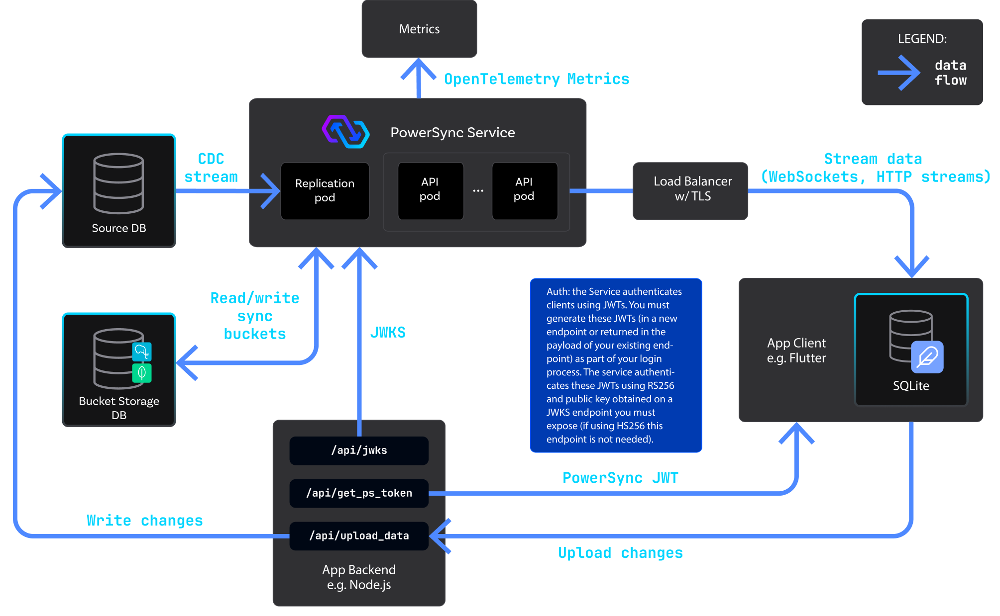

## Minimal Setup

For a runnable development setup, use the [self-hosting examples](https://github.com/powersync-ja/self-host-demo), which include Docker Compose files and configuration.

For development and testing, use:

1. One PowerSync container running in [unified mode](/configuration/powersync-service/self-hosted-instances#service-commands) (API and replication): 1 vCPU, 512 MiB memory.
2. A MongoDB or Postgres [bucket storage](#storage-requirements) database. For MongoDB, use one node in replica set mode: 1 vCPU, 2 GiB memory (M10+ on Atlas).
3. A load balancer for TLS.

This setup has no redundancy. If bucket storage data is lost, [re-replicate from the source database](#backups). All clients must then download their data again.

## Production

Run [API and replication](/configuration/powersync-service/self-hosted-instances#service-commands) in separate containers so you can scale them independently.

### Storage Requirements

You can use MongoDB or Postgres for bucket storage, independently of your source database:

- [MongoDB](/configuration/powersync-service/self-hosted-instances#mongodb-storage) supports [storage version 4](/sync/advanced/compatibility#available-versions) and optional S3 object storage. Use a three-node replica set for production.
- [Postgres](/configuration/powersync-service/self-hosted-instances#postgres-storage) uses [storage version 2](/sync/advanced/compatibility#available-versions). It does not support storage version 4 or S3 object storage.

With [S3 object storage](/sync/advanced/storage-version-4#self-hosted-s3-setup), S3 stores larger blocks of sync data while MongoDB retains smaller blocks and metadata.

### Compute Sizing

Use these CPU and memory settings as a starting point. These may be scaled up or down depending on your specific load patterns.

| Role | vCPU | Memory |
| --- | --- | --- |
| API | 1 | 2 GiB |
| Replication | 2 | 4 GiB |

### Replication Container

Run [`start -r sync`](/configuration/powersync-service/self-hosted-instances#service-commands) to replicate source changes into bucket storage.

Only one process can replicate from the source database at a time. Running multiple replication containers provides failover, not more throughput. It is recommended to run 2 replication processes for failover purposes.

During rolling deploys or failover, [`PSYNC_S1003`](/debugging/error-codes#psync_s1xxx-replication-issues) is expected briefly while another process holds the replication lock.

Size replication for source database write volume, row size, and buckets per row. A row in ten buckets creates more replication work than a row in one bucket. Initial replication and catch-up after a large batch update can need more capacity than steady-state replication.

Use [replication lag](/maintenance-ops/replication-lag), replication throughput, CPU, memory, and database metrics to assess capacity.

### API Containers

Run at least two API containers in production for high availability. Scale horizontally by adding API containers as the concurrent client load grows.

Run [`start -r api`](/configuration/powersync-service/self-hosted-instances#service-commands) for client connections. Collect [metrics](/maintenance-ops/self-hosting/monitoring) separately from API and replication containers.

The [`max_concurrent_connections`](/configuration/powersync-service/self-hosted-instances#param-max-concurrent-connections) config parameter determines the maximum number of concurrent client connections that each API process can handle. The default is `200`. We recommend keeping autoscaling targets below the `max_concurrent_connections` limit (e.g. ~100 concurrent connections per API process) to allow for headroom.

<Note>
  Depending on the use case, handling up to 1,000 concurrent clients per API process is possible. [Contact us](/resources/contact-us) to discuss your specific requirements and we will recommend an optimal setup.
</Note>

Scale on both CPU utilization and concurrent connections per API process. Idle connections can keep CPU low, while initial syncs can saturate CPU with fewer connections.

Add API containers before many clients are expected to run an initial sync at once, or before deployments that make clients download all their data again. Wait for the new containers to become healthy before those initial syncs or deployments begin. Adding containers does not immediately redistribute existing long-lived connections. Reduce capacity gradually after the download load subsides.

### Compact Job

Run [`compact`](/configuration/powersync-service/self-hosted-instances#service-commands) as a separate scheduled job, [hourly for storage version 4](/maintenance-ops/compacting-buckets#self-hosted-powersync) or daily for [storage version 2](/sync/advanced/compatibility#available-versions).

Compaction resources depend on bucket size, accumulated changes, and concurrency. Monitor completion, duration, CPU, and peak memory to size the job for your dataset. If jobs fail or overlap, check the compact job's CPU and memory usage and bucket storage performance before changing resources or the schedule. See [Compacting Buckets](/maintenance-ops/compacting-buckets#self-hosted-powersync).

### Memory Configuration

Set the environment variable `NODE_OPTIONS=--max-old-space-size-percentage=80` for the API, replication, and compact containers. This allocates 80% of the container’s assigned memory to the Node.js heap. This avoids manually retuning when scaling resources up or down.

### Load Balancer

Use a redundant load balancer to terminate TLS and distribute connections across API containers. Host the API on a dedicated subdomain.

For HTTP streaming with [nginx](https://nginx.org/en/), add this proxy block to your TLS server configuration. Replace `powersync:8080` with your PowerSync API hostname and port. Disabling response buffering lets sync data reach clients as it arrives.

```nginx
location / {
    proxy_pass http://powersync:8080;
    proxy_set_header Host $host;
    proxy_set_header X-Real-IP $remote_addr;
    proxy_set_header X-Forwarded-For $proxy_add_x_forwarded_for;
    proxy_buffering off;
}
```

For nginx Kubernetes ingress, use this annotation:

```yaml
nginx.ingress.kubernetes.io/proxy-buffering: "off"
```

### Health Checks

Configure load-balancer health checks to poll `/probes/liveness`. See [Health Checks](/maintenance-ops/self-hosting/healthchecks).

### Migrations

Occasionally, new versions of the PowerSync Service image may require migrations on the underlying storage database. This is also specifically required the first time the service starts up on a new storage database.

Replication containers run storage migrations on startup. [Unified](/configuration/powersync-service/self-hosted-instances#service-commands) containers, which run both API and replication, also run them. API containers do not run migrations.

Large migrations can delay startup during an update. To run migrations as a separate job before replacing the containers, disable automatic migrations:

```yaml service.yaml
migrations:
  disable_auto_migration: true
```

Then run [`migrate up`](/configuration/powersync-service/self-hosted-instances#service-commands) as a separate job before each deployment, including the first.

## Backups

Keep non-secret configuration in version control and credentials in a secrets manager.

None of the containers use any local storage, so no backups are required there.

Recover PowerSync's sync data by re-replicating from the source database. Allow for the time and capacity needed for full replication and for clients to download their data again.

## High Availability and Disaster Recovery

The [production setup](#production) covers the failure of a single container or node. To keep syncing during a regional outage, run a second PowerSync instance in a different region as a standby. For example, if your primary instance runs in `us-east-1`, run the standby in `us-west-2`.

### Standby Instance

Deploy the complete stack to the second region: replication containers, API containers, the compact job, a load balancer, and a bucket storage database.

- **Use the same source database.** Both instances replicate from it independently. This setup does not protect the source database. For a replicated Postgres source database, see the high availability section in [Schemas and Connections](/sync/advanced/schemas-and-connections).
- **Use separate bucket storage.** Each instance needs its own bucket storage database in its own region and, if enabled, its own [S3 bucket or prefix](/sync/advanced/storage-version-4#self-hosted-s3-setup). Two instances cannot share bucket storage, and storage in the failed region is unavailable during the outage.
- **Keep the standby running.** A running standby stays up to date with the source database, so clients can connect to it as soon as you switch. A standby that starts during the outage must complete its initial replication first.
- **Keep Sync Config and authentication consistent.** Deploy the same [Sync Config](/sync/streams/overview) to both instances. Configure [client authentication](/configuration/auth/overview) so that both instances accept the tokens that your backend issues: use the same keys and the same [`audience`](/configuration/auth/custom) values on both. If your tokens use an instance URL as the audience, add both instance URLs to `audience` on each instance.

For a Postgres source database, each instance uses its own [replication slots](/configuration/source-db/postgres-maintenance#maximum-replication-slots). Set a different [`slot_name_prefix`](/configuration/powersync-service/self-hosted-instances#param-slot-name-prefix) for each instance so that you can identify which instance a slot belongs to.

### Switching Clients to the Standby

Return the PowerSync endpoint from your backend API instead of hardcoding it in the app. Your [`fetchCredentials()`](/configuration/app-backend/client-side-integration) implementation can get the endpoint in the same API call that returns the token. To switch clients to the standby, change the endpoint that your API returns.

Host this API so that it remains available when the primary region fails.

The client SDK caches credentials and [fetches new ones](/configuration/app-backend/client-side-integration#when-fetchcredentials-is-called) when the token expires or the app restarts. A client that is already running therefore keeps trying the failed endpoint until its token expires. Use a short token lifetime, such as 5 to 15 minutes, to reduce this delay.

Do not load-balance clients between the two instances. A client that alternates between instances downloads all of its data again on every switch. See [Mapping Users to PowerSync Endpoints](/maintenance-ops/self-hosting/multiple-instances#mapping-users-to-powersync-endpoints).

### What Clients Experience

<Note>
  After the switch, each client performs an initial sync again from the standby.
</Note>

The client keeps its local data during the switch:

- The app can read and write the local database for the whole process.
- Pending writes stay in the upload queue. The client uploads them through your backend, which does not depend on the PowerSync instance.
- New changes from the source database appear after the sync completes.

Every client downloads all of its data from the standby at about the same time, which puts initial-sync load on the standby's API containers and bucket storage. [Add API containers](#api-containers) to the standby before you switch.

### After the Outage

For a Postgres source database, the replication slots of the stopped instance continue to retain WAL on the source database. Restore the instance so that it can catch up, or [drop its replication slots](/maintenance-ops/production-readiness-guide#managing-replication-slots).

Switching back to the original region makes every client sync all of its data again. Switch back only if you need to, and add API containers in that region first to handle a surge of concurrent client reconnections.

## Self-Hosted Architecture Diagram

The diagram omits S3 object storage.

<Frame caption="PowerSync Deployment Architecture">
  
</Frame>
