Field and delivery apps must continue to operate even when the device is offline.

This guide takes an online-only app built with .NET MAUI, ASP.NET Core, and SQL Server, and makes it work offline by using a local-first architecture. The SQL Server database and the backend API are largely unchanged. The app gets a local SQLite database, and it reads from and writes to only that database. There is one code path, whether the device is online or offline. PowerSync syncs the local database with SQL Server.

The example is a delivery-driver app. Drivers see today's stops and record each one as delivered or failed. Dispatch is a back-office system that writes straight to SQL Server, and it adds and cancels stops.

The [companion repo](https://github.com/ckritzinger/sql_server_courier_example) has both versions: the original REST app on the `main` branch, and the updated architecture using PowerSync on the `powersync-existing-api` branch.

{/* TODO: Confirm the repo's final home (personal GitHub or `powersync-ja`) and update every repo link on this page before publishing. */}

<Note>
  The [SQL Server source](/configuration/source-db/setup#sql-server) and the [.NET SDK](/client-sdks/reference/dotnet) are in [Beta](/resources/feature-status).
</Note>

## The Starting Point: An Online-Only REST App

The app calls the backend API for everything. A dispatch script writes to SQL Server directly, as a back-office or ERP system would.

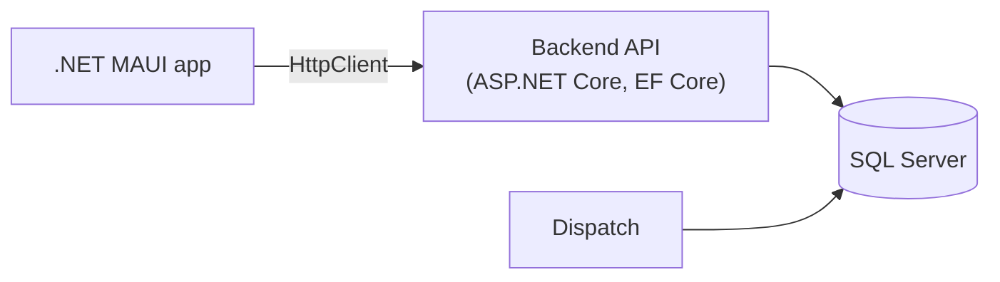

There are two tables, both with server-generated `NEWSEQUENTIALID()` GUIDs:

- `stops`: driver, route date, sequence, recipient, address, and a status of `assigned`, `delivered`, `failed`, or `cancelled`.
- `deliveries`: one row per attempt, with the outcome, a note, and `recorded_at`.

The backend API signs RS256 tokens and publishes the public key at `/.well-known/jwks.json`, the way Entra ID or any other identity provider does.

To record an outcome, the app calls `POST /api/stops/{id}/deliveries`. This endpoint enforces the app's one business rule: it returns 409 if dispatch canceled the stop or the stop is already delivered. The endpoint locks the stop row first, so a cancel that arrives at the same moment can't slip in.

The full code is on the repo's [`main` branch](https://github.com/ckritzinger/sql_server_courier_example/tree/main).

<Columns cols={2}>
  <Frame caption="The day's route, part done.">
    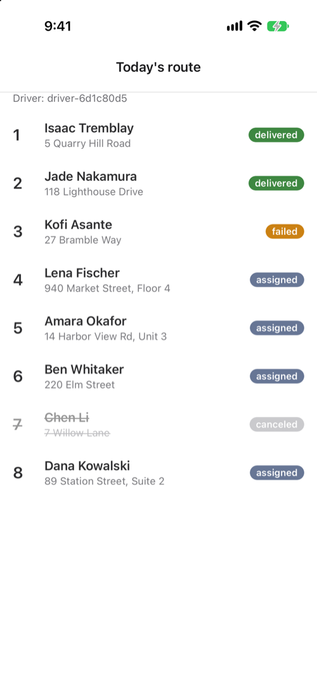
  </Frame>
  <Frame caption="A stop with a failed attempt, ready to try again.">
    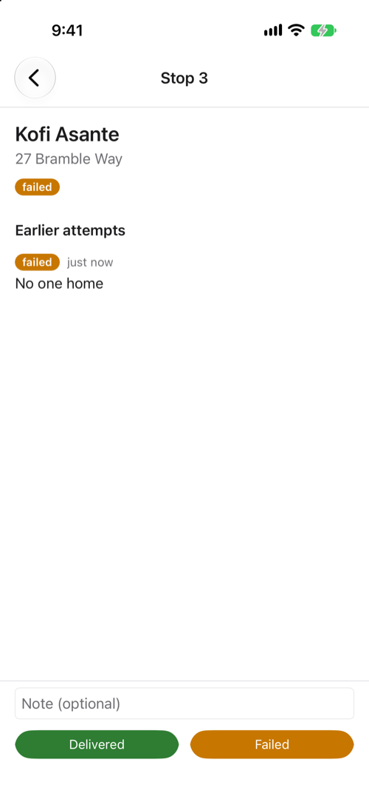
  </Frame>
</Columns>

### Failure Modes

The REST-based app fails in three ways:

- If the driver records an outcome while offline, they get an error banner and have to try again later.
- If the driver opens the app while offline, the screen is empty, so they can't see where to go.
- If dispatch cancels a stop, it still shows as assigned until the driver refreshes. A delivery attempt on it then fails with a 409.

Dispatch canceled stop 4 after the driver opened it. The page still shows the stop as assigned. When the driver taps **Delivered**, the backend API returns 409. In the same way, the route list keeps showing a canceled stop as assigned until the driver pulls to refresh.

<Columns cols={3}>
  <Frame caption="Stop 4, canceled by dispatch, still shows as assigned.">
    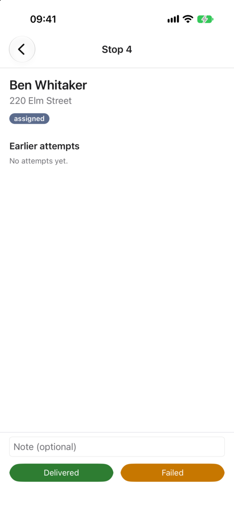
  </Frame>
  <Frame caption="Tapping Delivered gets a 409.">
    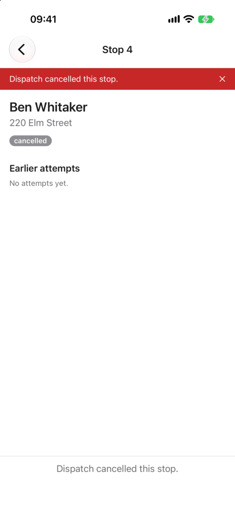
  </Frame>
  <Frame caption="No network: opening the app shows an empty route.">
    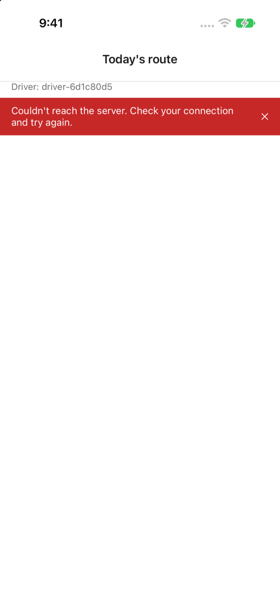
  </Frame>
</Columns>

### Baseline Code

The route list loads when the page appears and on pull-to-refresh. With no network, the list is empty:

```csharp
async Task LoadAsync()
{
    try
    {
        var stops = await api.GetStopsAsync();
        // ...replace the list.
    }
    catch (ApiException ex)
    {
        // No cache: show what the backend API last returned, which is nothing.
        Stops.Clear();
        ErrorMessage = ErrorMessages.For(ex);
    }
}
```

Recording an outcome makes the HTTP call. It has three failure paths (a 409, a network error, and a failed reload), a reload, and a fallback for when the reload fails:

```csharp
async Task RecordAsync(string outcome)
{
    // ...set the busy flag and read the note.
    try
    {
        var result = await api.RecordDeliveryAsync(stop.Id, outcome, note);
        Stop = result.Stop;
        ErrorMessage = null;
        try
        {
            await ReloadAsync(); // Pick up attempts recorded elsewhere.
        }
        catch (ApiException)
        {
            if (Deliveries.All(d => d.Id != result.Delivery.Id))
                Deliveries.Add(result.Delivery);
        }
    }
    catch (ApiException ex) when (ex.StatusCode == HttpStatusCode.Conflict)
    {
        // The backend API said no (for example, dispatch canceled the stop). Show why, then the real status.
        ErrorMessage = ex.Message;
        try { await ReloadAsync(); } catch (ApiException) { }
    }
    catch (ApiException ex)
    {
        // Keep the note so the driver can press the button again. No queueing, no automatic retry.
        ErrorMessage = ErrorMessages.For(ex);
    }
    // ...clear the busy flag.
}
```

## Migrating to Local-First

In the new architecture, the app reads and writes its local SQLite database. The PowerSync Service streams changes from SQL Server to the device, and the client SDK uploads local writes through the existing backend API.

To see a full diff of the migration, including the backend API change, see the [pull request in the companion repo](https://github.com/ckritzinger/sql_server_courier_example/pull/1/changes).

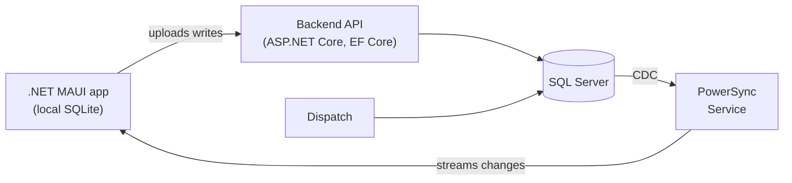

### What Changes and What Stays

| | Before | After |
| --- | --- | --- |
| Reads | `HttpClient` calls to REST | Watched local SQLite queries. The UI updates live |
| Writes | `POST` to the backend API, which fails offline | Local write adds to the [upload queue](/architecture/client-architecture#writing-data-via-sqlite-database-and-upload-queue). The same `POST` is sent once the device is online |
| Dispatch changes | Seen after a refresh | Appear on the device in a few seconds |
| IDs | Server `NEWSEQUENTIALID()` | Generated on the device (same column type) |
| Auth | RS256 and JWKS | Unchanged. The PowerSync Service reads the same JWKS |
| SQL Server | Plain tables | Identical tables, CDC enabled |
| Backend API | REST endpoints | Stays. One endpoint accepts the device's ID and tap time, and treats a repeat as already done. Read endpoints are no longer needed |

## Step 1: Prepare SQL Server for CDC

The [PowerSync Service](/architecture/powersync-service) reads changes from SQL Server through [Change Data Capture (CDC)](https://learn.microsoft.com/en-us/sql/relational-databases/track-changes/about-change-data-capture-sql-server). Your tables are unchanged: CDC adds change tables next to them. A SQL Server Agent job fills those tables from the transaction log. The PowerSync Service polls the change tables and turns each change into sync data.

This step usually needs a DBA. Check the requirements below, then run the setup script.

### SQL Server Compatibility Checklist

- **Edition**: Use SQL Server 2019 or later (Standard, Enterprise, Developer, or Evaluation), Azure SQL Database, or Azure SQL Managed Instance. Azure SQL Database needs a vCore tier, or S3 and up on DTU. Express and Web editions don't have CDC, so the PowerSync Service can't replicate from them.
- **Permissions**: Enabling CDC on the database needs `sysadmin` (`db_owner` on Azure SQL). You do this once. The PowerSync Service then connects as a read-only user.
- **SQL Server Agent must be running**: If the Agent is stopped, enabling CDC still succeeds, but the change tables stay empty and the PowerSync Service never sees an update. In the official Docker image, the Agent is off by default, so set `MSSQL_AGENT_ENABLED=true`. This item doesn't apply to Azure SQL Database, which manages the CDC jobs itself.
- **Transaction log**: CDC reads the log, so SQL Server can't free log space until the capture job has processed it. Monitor log growth and the retention of the CDC cleanup job.
- **Delayed durability must be off**: SQL Server refuses to enable CDC on a database with delayed durability set. It also refuses to turn delayed durability on (`FORCED` or `ALLOWED`) while CDC is enabled. Run `SELECT delayed_durability_desc FROM sys.databases` and make sure that it returns `DISABLED`.
- **Sync tables, not views**: CDC captures only tables. If you name a view in your Sync Streams, the PowerSync Service stops replicating and logs the PowerSync error [`PSYNC_S1602`](/debugging/error-codes#psync_s16xx-mssql-replication-issues). The solution is to sync the underlying tables and do the join on the client.
- **Don't sync computed columns**: The initial copy reads the real value, but CDC records computed columns (persisted or not) as `NULL`, so every later insert or update syncs `NULL`. Leave them out of your Sync Stream queries and compute the value on the client, or write it to a normal column.
- **Prefer a single-column primary key**: The PowerSync Service copies tables keyed on one column in resumable batches. It copies other tables (composite keys or no key) in one pass, and starts again from zero if it restarts mid-copy.

### The Setup Script

The companion repo does all of this in one idempotent script, [`db/powersync.sql`](https://github.com/ckritzinger/sql_server_courier_example/blob/powersync-existing-api/db/powersync.sql), which runs as a one-shot container after the app's own `init.sql`. The steps below show a trimmed version. Replace `CourierApp` and the table names with your own.

<Steps>
  <Step title="Fail Early If SQL Server Agent Is Off">
    If the Agent is stopped, CDC enables without error but captures nothing. This check stops the script instead.

    ```sql
    USE CourierApp;
    GO

    IF NOT EXISTS (
      SELECT 1 FROM sys.dm_server_services
      WHERE servicename LIKE N'SQL Server Agent%' AND status_desc = N'Running'
    )
      THROW 50000, 'SQL Server Agent is not running, so CDC would capture nothing.', 1;
    GO
    ```
  </Step>
  <Step title="Enable CDC on the Database, Then on Each Table to Sync">
    Name every replicated table here and in your Sync Streams (Step 3).

    ```sql
    IF (SELECT is_cdc_enabled FROM sys.databases WHERE name = N'CourierApp') = 0
      EXEC sys.sp_cdc_enable_db;
    GO

    IF NOT EXISTS (SELECT 1 FROM cdc.change_tables WHERE source_object_id = OBJECT_ID(N'dbo.stops'))
      EXEC sys.sp_cdc_enable_table
        @source_schema = N'dbo', @source_name = N'stops',
        @role_name = N'cdc_reader', @supports_net_changes = 0;
    GO
    -- ...and the same for dbo.deliveries
    ```
  </Step>
  <Step title="Create a Read-Only Login for the PowerSync Service">
    ```sql
    USE master;
    IF NOT EXISTS (SELECT 1 FROM sys.server_principals WHERE name = N'powersync_user')
      CREATE LOGIN powersync_user WITH PASSWORD = N'$(POWERSYNC_DB_PASSWORD)', CHECK_POLICY = ON;
    ELSE
      ALTER LOGIN powersync_user WITH PASSWORD = N'$(POWERSYNC_DB_PASSWORD)';
    GRANT VIEW SERVER PERFORMANCE STATE TO powersync_user;  -- SQL Server only, not Azure SQL
    GO

    USE CourierApp;
    IF NOT EXISTS (SELECT 1 FROM sys.database_principals WHERE name = N'powersync_user')
      CREATE USER powersync_user FOR LOGIN powersync_user;
    GRANT SELECT ON dbo.stops TO powersync_user;
    GRANT SELECT ON dbo.deliveries TO powersync_user;
    IF IS_ROLEMEMBER(N'cdc_reader', N'powersync_user') = 0
      ALTER ROLE cdc_reader ADD MEMBER powersync_user;
    GRANT SELECT ON SCHEMA::cdc TO powersync_user;
    GRANT VIEW DATABASE PERFORMANCE STATE TO powersync_user;
    GO
    ```

    The script is a `sqlcmd` script: pass the password with `-v POWERSYNC_DB_PASSWORD="..."`. The `ALTER LOGIN` branch makes sure that running the script again picks up a changed password.
  </Step>
  <Step title="Add the Checkpoints Table">
    The PowerSync Service writes to this table to mark consistent points in the CDC stream. The table needs CDC too.

    ```sql
    IF OBJECT_ID(N'dbo._powersync_checkpoints', N'U') IS NULL
      CREATE TABLE dbo._powersync_checkpoints (
        id INT IDENTITY PRIMARY KEY,
        last_updated DATETIME NOT NULL DEFAULT GETUTCDATE()
      );
    GO
    -- sp_cdc_enable_table for it, as above
    GRANT SELECT, INSERT, UPDATE ON dbo._powersync_checkpoints TO powersync_user;
    GO
    ```
  </Step>
  <Step title="Make the Capture Job Scan Every Second">
    The default interval is 5 seconds. This interval is most of the delay between a write in SQL Server and the change reaching devices.

    ```sql
    EXEC sys.sp_cdc_change_job @job_type = N'capture',
      @pollinginterval = 1, @maxtrans = 5000, @maxscans = 10;
    ```

    The new settings take effect only when the capture job restarts. Restart SQL Server Agent, stop and start the job, or restart the SQL Server container.

    On Azure SQL Database, you can't change this setting. The capture interval is fixed at 20 seconds, which sets a floor on how quickly changes in SQL Server reach devices.
  </Step>
</Steps>

## Step 2: Run the PowerSync Service

This guide [self-hosts](/intro/self-hosting) the PowerSync Service with Docker Compose (see the repo's [`docker-compose.yml`](https://github.com/ckritzinger/sql_server_courier_example/blob/powersync-existing-api/docker-compose.yml)).

You can also use [PowerSync Cloud](/configuration/powersync-service/cloud-instances).

<Note>PowerSync Cloud [Private Endpoints](/configuration/source-db/private-endpoints) don't currently support SQL Server, so an on-premises database needs a network route that PowerSync Cloud can reach.</Note>

### Configure the PowerSync Service

```yaml service.yaml
replication:
  connections:
    - type: mssql
      uri: !env PS_DATA_SOURCE_URI
      schema: dbo
      additionalConfig:
        trustServerCertificate: true   # Local container with a self-signed certificate. In production, use a trusted certificate.

storage:
  type: mongodb
  uri: !env PS_MONGO_URI

port: 8080

sync_config:
  path: sync-config.yaml

client_auth:
  jwks_uri: http://server:7070/.well-known/jwks.json
  audience: ["courier-api"]
```

`PS_DATA_SOURCE_URI` has the form `mssql://powersync_user:<password>@sqlserver:1433/CourierApp`.

<Note>If your password isn't URL-safe, you must URL-encode it.</Note>

Devices authenticate to the PowerSync Service with a JWT. If your backend API already issues JWTs signed with an asymmetric key and publishes a JWKS (as Entra ID, Auth0, and most identity providers do), point `client_auth.jwks_uri` at it and set the audience that your tokens carry. See [Custom Authentication](/configuration/auth/custom) for other token setups.

## Step 3: Define the Data That Each Device Gets

Use [Sync Streams](/sync/streams/overview) to define which rows go to which device. In this example, each driver gets their own stops and delivery attempts:

```yaml sync-config.yaml
config:
  edition: 3

streams:
  my_route:
    auto_subscribe: true
    queries:
      - SELECT * FROM stops WHERE driver_id = auth.user_id()
      - SELECT * FROM deliveries WHERE driver_id = auth.user_id()
```

- `auth.user_id()` is the `sub` claim from the token in Step 2. The filter runs in the PowerSync Service, so a device receives only its own driver's rows.
- `auto_subscribe: true` means that the app doesn't have to subscribe to this stream. It syncs as soon as the app connects.

After you change this file, restart the PowerSync Service container. A change to Sync Streams makes the PowerSync Service reprocess the data. That takes seconds for this example, but on a large database you need to plan for it (see [Schema Changes](#schema-changes)).

## Step 4: Swap the App's Reads to Local SQLite

Add version 1.0.0 of the `PowerSync.Common` and `PowerSync.Maui` NuGet packages.

<Note>To run on the iOS simulator, version 1.0.0 currently needs a [`.csproj` workaround](https://github.com/ckritzinger/sql_server_courier_example/blob/powersync-existing-api/app/CourierApp/CourierApp.csproj), because the package links the SQLite build for physical devices.</Note>

{/* TODO: Before publishing, check whether a PowerSync.Maui release after 1.0.0 includes the iOS simulator fix. If it does, remove the workaround sentence and update the version. */}

### Define the Schema

The client-side schema is one C# class for every local table. These classes also serve as query result types, and replace the backend API's DTOs:

```csharp AppSchema.cs
using System.Globalization;
using PowerSync.Common.DB.Schema.Attributes;
using PS = PowerSync.Common.DB.Schema;

[Table("stops")]
[Index("route", ["route_date", "sequence"])]
public class Stop
{
    [Column("id")] public string Id { get; set; } = "";
    [Column("driver_id")] public string DriverId { get; set; } = "";
    [Column("route_date")] public string RouteDate { get; set; } = "";
    [Column("sequence")] public int Sequence { get; set; }
    [Column("recipient")] public string Recipient { get; set; } = "";
    [Column("address")] public string Address { get; set; } = "";
    [Column("status")] public string Status { get; set; } = "";
    [Column("updated_at")] public string UpdatedAt { get; set; } = "";
}

[Table("deliveries")]
[Index("stop_recorded", ["stop_id", "recorded_at"])]
public class Delivery
{
    [Column("id")] public string Id { get; set; } = "";
    [Column("stop_id")] public string StopId { get; set; } = "";
    [Column("driver_id")] public string DriverId { get; set; } = "";
    [Column("outcome")] public string Outcome { get; set; } = "";
    [Column("note")] public string? Note { get; set; }
    [Column("recorded_at")] public string RecordedAt { get; set; } = "";
}

public static class AppSchema
{
    public static readonly PS.Schema Schema = new(new PS.Table(typeof(Stop)), new PS.Table(typeof(Delivery)));

    // Upper case, because that's how SQL Server's UNIQUEIDENTIFIER comes back through the PowerSync Service:
    // a lower-case local ID would sync back as a second, different row.
    public static string NewId() => Guid.NewGuid().ToString().ToUpperInvariant();

    // The format the PowerSync Service sends DATETIME2 in, so ORDER BY sorts local and synced rows the same way.
    public static string UtcNow() =>
        DateTime.UtcNow.ToString("yyyy-MM-dd'T'HH:mm:ss.fffffff'00Z'", CultureInfo.InvariantCulture);

    // Today's route date, in the format the PowerSync Service sends DATE in.
    public static string Today() => DateTime.UtcNow.ToString("yyyy-MM-dd", CultureInfo.InvariantCulture);
}
```

### On Startup: Open the Database and Connect

Open the database and call `Connect()` during app init. The pages read local data, so they don't wait for the connection:

```csharp Database.cs
public Database(CourierConnector connector, ILogger<Database> logger)
{
    _connector = connector;
    Db = new PowerSyncDatabase(new PowerSyncDatabaseOptions
    {
        Database = new MAUISQLiteDBOpenFactory(new MDSQLiteOpenFactoryOptions
        {
            DbFilename = Path.Combine(FileSystem.AppDataDirectory, "courier.db"),
        }),
        Schema = AppSchema.Schema,
        Logger = logger,
    });
}

/// Opens the database and starts syncing. Call once at startup. This also works offline.
public Task StartAsync() => _started ??= StartCoreAsync();

async Task StartCoreAsync()
{
    await Db.Init();
    // Connect keeps retrying in the background while the PowerSync Service is unreachable.
    await Db.Connect(_connector);
}
```

```csharp App.xaml.cs
public App(Database database)
{
    InitializeComponent();
    _ = database.StartAsync();
}
```

The connector's `FetchCredentials()` gets a token from the backend API's existing token endpoint. The PowerSync Service checks the token against the same JWKS as the backend API:

```csharp CourierConnector.cs
public class CourierConnector(ApiClient api) : IPowerSyncBackendConnector
{
    public async Task<PowerSyncCredentials?> FetchCredentials()
    {
        var token = await api.FetchTokenAsync();
        return new PowerSyncCredentials(AppConfig.PowerSyncUrl, token.Token, token.ExpiresAt);
    }

    // UploadData: see Step 5
}
```

### Replace the REST-Based Loads with Watch Queries

The route list now [watches](/client-sdks/watch-queries) a local query instead of calling the backend API. A stop that dispatch adds or cancels appears without a refresh, and the list works offline:

```csharp
async Task WatchStopsAsync(CancellationToken ct)
{
    var results = Database.Db.Watch<Stop>(
        "SELECT * FROM stops WHERE route_date = ? ORDER BY sequence", [AppSchema.Today()],
        new SQLWatchOptions { Signal = ct, TriggerImmediately = true });

    await foreach (var stops in results.WithCancellation(ct))
    {
        // Each result is the whole list. With 8-10 stops, replace it.
        await MainThread.InvokeOnMainThreadAsync(() =>
        {
            Stops.Clear();
            foreach (var stop in stops)
                Stops.Add(stop);
        });
    }
}
```

### Code You No Longer Need

- The `GET` calls in the backend API client.
- The backend API's DTOs. The schema classes replace them.
- The load and reload methods, and their error paths.
- Both pull-to-refresh views.

<Columns cols={2}>
  <Frame caption="The route list, read from the local database.">
    
  </Frame>
  <Frame caption="The stop page, read from the local database.">
    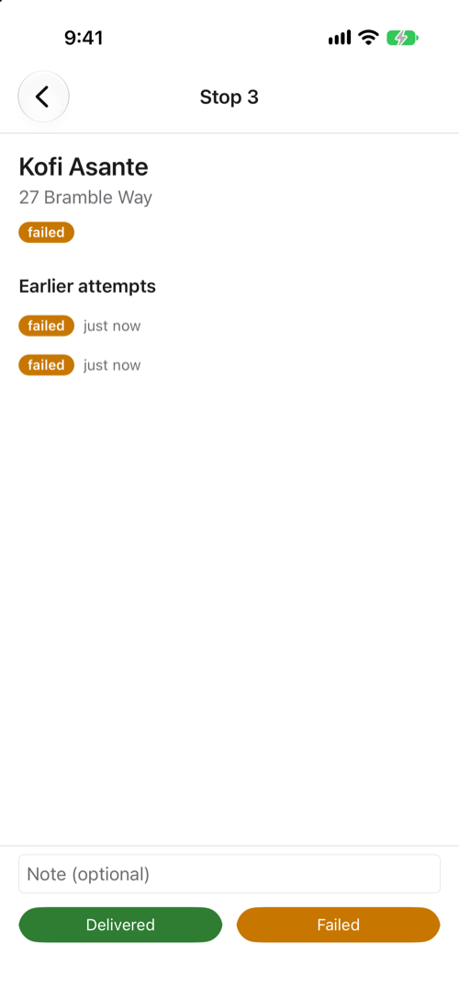
  </Frame>
</Columns>

## Step 5: Move Writes to the Upload Queue

### Record an Outcome Locally

Recording an outcome becomes one local transaction: insert the delivery, then update the stop's status. There is no network call, so there is no network error path. The page updates through its watched queries:

```csharp
async Task RecordAsync(string outcome)
{
    var note = string.IsNullOrWhiteSpace(Note) ? null : Note.Trim();
    await Database.Db.WriteTransaction(async tx =>
    {
        await tx.Execute(
            "INSERT INTO deliveries (id, stop_id, driver_id, outcome, note, recorded_at) VALUES (?, ?, ?, ?, ?, ?)",
            [AppSchema.NewId(), stop.Id, stop.DriverId, outcome, note, AppSchema.UtcNow()]);
        await tx.Execute("UPDATE stops SET status = ? WHERE id = ?", [outcome, stop.Id]);
    });
    Note = "";
}
```

The device generates the delivery's ID with `Guid.NewGuid()`, in upper case. Because the ID exists before the upload, a retry or an offline create targets the same row. See [Client ID](/sync/advanced/client-id).

### Upload Through the Existing API

The write goes into the [upload queue](/architecture/client-architecture#writing-data-via-sqlite-database-and-upload-queue). The client SDK calls the connector's `UploadData()`, which posts the delivery to the existing endpoint.

```csharp CourierConnector.cs
public async Task UploadData(IPowerSyncDatabase database)
{
    var transaction = await database.GetNextCrudTransaction();
    if (transaction is null)
        return;

    foreach (var op in transaction.Crud)
    {
        if (op is { Table: "deliveries", Op: UpdateType.PUT })
            await UploadDeliveryAsync(database, op);
        else if (op is { Table: "stops", Op: UpdateType.PATCH } && op.OpData?.Keys.All(k => k == "status") == true)
            continue; // The backend API sets the status itself. The local patch only updates the UI.
    }

    await transaction.Complete();
}

async Task UploadDeliveryAsync(IPowerSyncDatabase database, CrudEntry op)
{
    var stopId = Text(op, "stop_id")!;
    var outcome = Text(op, "outcome")!;
    try
    {
        await api.RecordDeliveryAsync(stopId, op.Id, outcome, Text(op, "note"), Text(op, "recorded_at")!);
    }
    catch (ApiException ex) when (ex.StatusCode is HttpStatusCode.BadRequest or HttpStatusCode.NotFound or HttpStatusCode.Conflict)
    {
        // The backend API will never accept this one. Drop it so later writes aren't blocked, and tell the driver.
        var stop = await database.GetOptional<Stop>("SELECT * FROM stops WHERE id = ?", [stopId]);
        LastRejection = new Rejection(stop?.Sequence, outcome, ex.Message);
        RejectionChanged?.Invoke(this, EventArgs.Empty);
    }
    catch (ApiException ex) when (ex.StatusCode is HttpStatusCode.Unauthorized)
    {
        api.ClearToken(); // The client SDK retries, and the next call fetches a new token.
        throw;
    }
    // Anything else (no network, a timeout, or a 5xx) propagates and the client SDK retries later.
}

static string? Text(CrudEntry op, string column) => op.OpData?.GetValueOrDefault(column)?.ToString();
```

`UploadData()` handles each response as the [existing API guide](/handling-writes/write-path/existing-api) describes:

- **2xx**: applied.
- **400, 404, and 409**: dropped and shown to the driver.
- **401**: refresh the token and retry.
- **Everything else**: retried.

### Change One Endpoint in the Backend API

The delivery endpoint now accepts the device's ID and the time of the tap. A retry can repeat a delivery that the backend API already recorded, so the endpoint returns 200 for a repeat before it applies the business rule. Otherwise, a retried "delivered" would get a 409 because the stop is already delivered:

```csharp
// Id and RecordedAt are optional: an offline client sends its own, older clients send neither.
public record DeliveryRequest(Guid? Id, string? Outcome, string? Note, DateTimeOffset? RecordedAt);
```

```csharp
// Inside the transaction, after locking the stop row.

if (request.Id is { } deliveryId &&
    await db.Deliveries.AsNoTracking().SingleOrDefaultAsync(
        d => d.Id == deliveryId && d.StopId == id && d.DriverId == driverId) is { } existing)
{
    return Results.Ok(new DeliveryResponse(StopDto.From(stop), DeliveryDto.From(existing)));
}

switch (stop.Status) // The business rule is unchanged.
{
    case StopStatus.Cancelled: return ApiResults.Conflict("Dispatch cancelled this stop.");
    case StopStatus.Delivered: return ApiResults.Conflict("This stop is already delivered.");
}

var delivery = new Delivery
{
    Id = request.Id ?? Guid.Empty,                         // With Guid.Empty, the database default applies.
    StopId = id, DriverId = driverId, Outcome = outcome, Note = note,
    RecordedAt = request.RecordedAt?.UtcDateTime ?? default, // The tap time, not the upload time.
};
```

### The Business Rule Stays in the Backend API

The business rule is unchanged. If a driver records a delivery offline on a stop that dispatch then cancels, the upload gets a 409, and a banner tells the driver. At the next sync, the local delivery disappears and the stop shows as canceled. This needs no extra code.

<Columns cols={2}>
  <Frame caption="Before: rejected while online.">
    
  </Frame>
  <Frame caption="After: recorded offline, then rejected on upload.">
    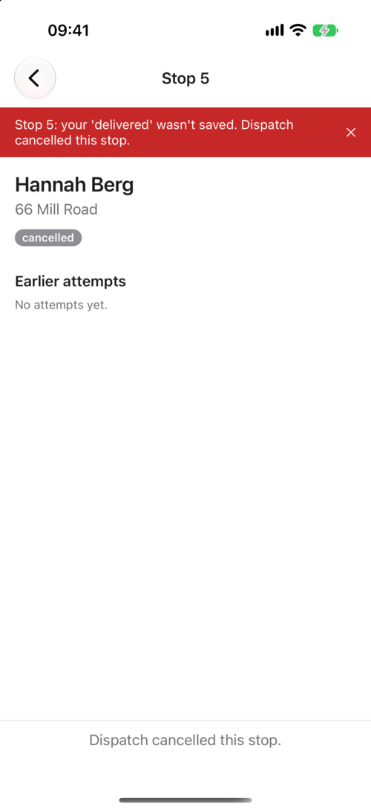
  </Frame>
</Columns>

<Warning>
  **Before you ship**: The companion repo is the minimum code needed for demonstration. It marks production hardening with `// Production:` comments:

  - **An ID reused by another driver**: The insert fails with a 500, which the client retries forever. Check for this case and return 400.
  - **The device clock**: `recorded_at` comes from the device. Check it against the backend API's clock.
  - **Rejections across restarts**: The rejection message is lost if the app restarts before the driver sees it. Keep it in a local-only table, or have the backend API record rejections in a table that syncs back.
</Warning>

## Step 6: Dispatch Changes Show Without a Refresh

Dispatch still writes straight to SQL Server. CDC picks up the change, and the PowerSync Service streams it to the device. Nothing in the app polls or refreshes.

The driver gets these updates without any app code:

- A stop that dispatch cancels or adds shows up while the driver is looking at the list.
- An attempt recorded on another device appears in seconds.
- Writes from any system reach the device, not only writes through your backend API.

<Columns cols={2}>
  <Frame caption="Stop 7 is assigned.">
    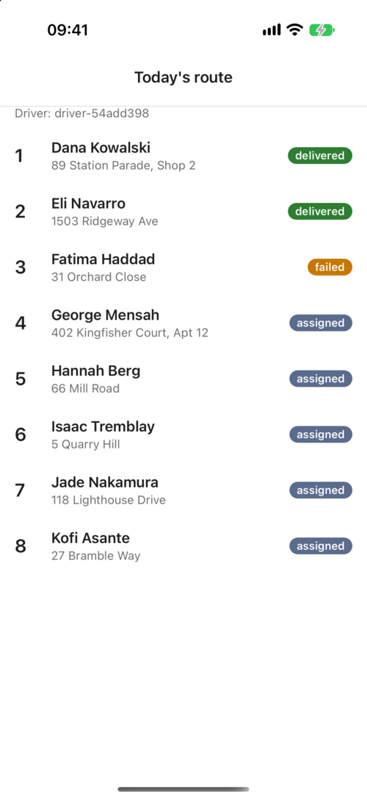
  </Frame>
  <Frame caption="Seconds after dispatch cancels it, with no refresh.">
    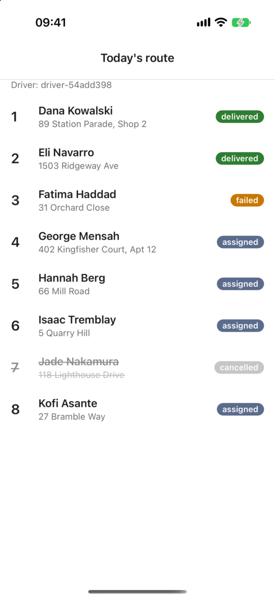
  </Frame>
</Columns>

## Step 7: Test Offline Behavior

To test offline behavior, cut the simulator's network, for example with the **100% Loss** profile in Network Link Conditioner.

<Columns cols={2}>
  <Frame caption="Before: recording an outcome with no network shows an error.">
    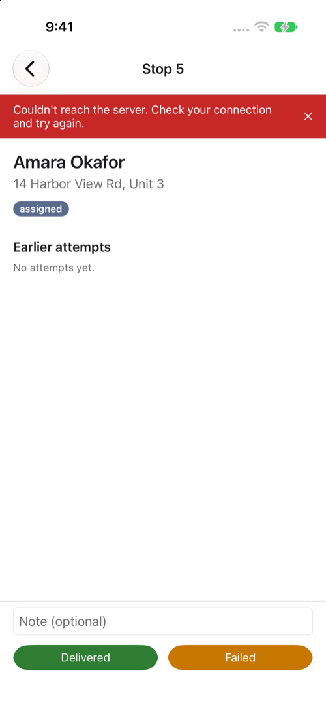
  </Frame>
  <Frame caption="After: the delivery is saved and queued for upload.">
    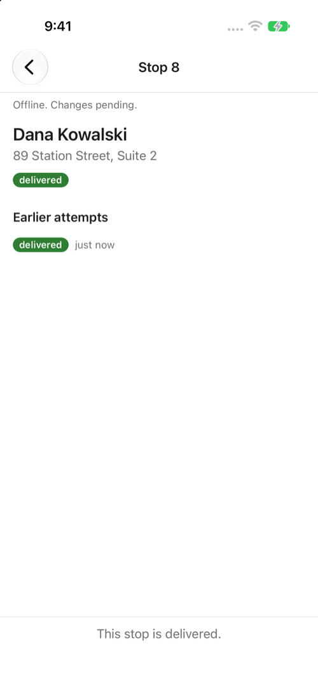
  </Frame>
  <Frame caption="Before: opening the app with no network shows an empty route.">
    
  </Frame>
  <Frame caption="After: the full route comes from the local database.">
    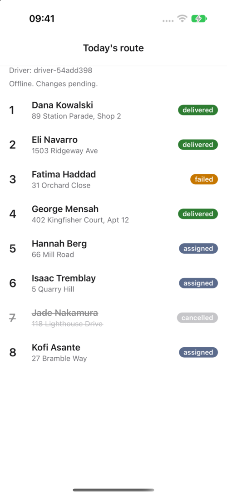
  </Frame>
</Columns>

<Warning>
  The client SDK calls `FetchCredentials()` on every connect, and in this example that calls your backend API's token endpoint. If your backend API is down, the app can't connect to the PowerSync Service either. Reads still work, because they're local. To keep sync running through an API outage, cache the token on the device and return it from `FetchCredentials()` until it expires.
</Warning>

## Schema Changes

SQL Server schema changes need a few manual steps. For example, to add a `signed_by` column to `deliveries` in the companion repo:

1. Run `ALTER TABLE`. Replication continues without the new column, and the PowerSync Service logs `Schema drift detected … Deploy a new sync config`.
2. Create a new capture instance with a new name. A table can have at most 2 capture instances.
3. Redeploy the [Sync Config](/sync/streams/overview). A restart alone does nothing, but a comment-only change counts as a redeploy. The redeploy starts a new replication stream with a full new snapshot. Clients keep syncing from the old stream until the new one is ready.
4. Disable the old capture instance.
5. On the client, add a property to the schema class. The client schema has no migrations.

See [SQL Server Specifics](/maintenance-ops/implementing-schema-changes#sql-server-specifics) for the full workflow.

## How This Compares with Datasync and Dotmim.Sync

[CommunityToolkit Datasync](https://communitytoolkit.github.io/Datasync/) and [Dotmim.Sync](https://github.com/Mimetis/Dotmim.Sync) are the other common options for MAUI and SQL Server.

| | Datasync | Dotmim.Sync | PowerSync |
| --- | --- | --- | --- |
| Changes to your schema | `Id`, `UpdatedAt`, and `Version` on every entity. Offline clients see deletes only with soft delete | Change Tracking enabled | CDC enabled. Tables unchanged |
| Backend API code | A table controller per table | None. Writes go database to database, bypass your backend API, and conflicts resolve per row | Your existing backend API |
| SQL Server changes reach the device | When the app pulls | When the app syncs | Streamed |
| SQL Server editions | Anything EF Core supports | Express works (Change Tracking) | 2019 and later. No Express |
| Platforms and maturity | .NET apps. Blazor is online only | .NET. Mostly one maintainer | MAUI and other platforms. Beta, and a service to run |

## Next Steps

<CardGroup cols={2}>
  <Card title="Companion Repo" icon="github" href="https://github.com/ckritzinger/sql_server_courier_example">
    The `main` branch is the REST app, and `powersync-existing-api` adds PowerSync.
  </Card>
  <Card title="SQL Server Setup" icon="database" href="/configuration/source-db/setup#sql-server">
    Full SQL Server source database setup.
  </Card>
  <Card title=".NET SDK (Beta)" icon="code" href="/client-sdks/reference/dotnet">
    Reference for the .NET SDK.
  </Card>
  <Card title="Use Your Existing API" icon="upload" href="/handling-writes/write-path/existing-api">
    How to upload local writes through the API you already have.
  </Card>
  <Card title="Offline-First Architecture Jargon" icon="book" href="/resources/architecture-guides/offline-first-architecture">
    The terms and patterns behind this guide.
  </Card>
  <Card title="Offline-First POS Architecture" icon="book" href="/resources/architecture-guides/offline-first-pos">
    The same patterns applied to a retail point-of-sale app.
  </Card>
</CardGroup>
