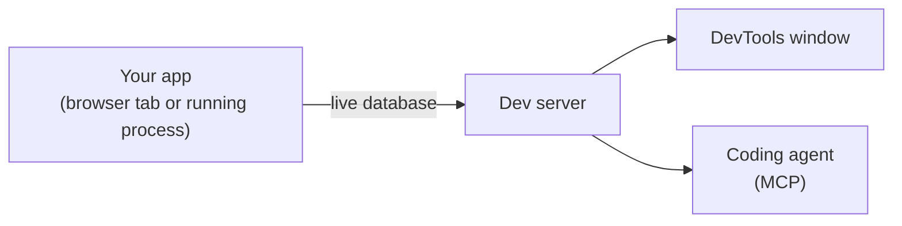

<Note>
  PowerSync DevTools is currently available for [Vite](/tools/devtools/vite), [Nuxt](/tools/devtools/nuxt), [Node.js](/tools/devtools/node) and [Dart/Flutter](/tools/devtools/dart) apps.
</Note>

Use PowerSync DevTools to:

- Check that the client is connected and up to date, and see sync errors.
- Look at the data on the device, and run SQL on it.
- See which buckets and Sync Streams the client syncs, and how far each one has downloaded.
- See the local changes that wait to upload.
- Inspect the client configuration, such as the endpoint, user ID, connection parameters, and schema.
- Read the SDK logs.
- Test offline behavior: disconnect, reconnect, or clear and re-sync.

Coding agents can query the same client and run sync actions through [MCP tools](/tools/devtools/mcp) when you use Vite, Nuxt DevTools 4, or Node.js.

DevTools runs in development only and adds nothing to a production build.

<Frame caption="PowerSync DevTools in the Vite DevTools dock.">
  
</Frame>

## How It Works

Your Vite or Nuxt dev server serves DevTools. In a Node.js app, your app process serves it instead.

DevTools reads from the database that your app has open, so it shows the same data that your app sees.

## Set Up DevTools

<CardGroup cols={3}>
  <Card title="Vite" icon="bolt" href="/tools/devtools/vite">
    React, Vue, Svelte, or any web app that uses Vite 7 or later.
  </Card>

  <Card title="Nuxt" icon="vuejs" href="/tools/devtools/nuxt">
    Nuxt apps that use `@powersync/nuxt` with Nuxt DevTools 3 or 4.
  </Card>

  <Card title="Node.js" icon="node-js" href="/tools/devtools/node">
    Node.js apps that use `@powersync/node`.
  </Card>

  <Card title="Dart/Flutter" icon="flutter" href="/tools/devtools/dart">
    Any Dart or Flutter app.
  </Card>
</CardGroup>

<Info>
  Support for more platforms is under consideration. To ask for a specific integration, submit an idea or vote for it on the [PowerSync Roadmap](https://roadmap.powersync.com).
</Info>

## Usage and MCP Tools

<CardGroup cols={2}>
  <Card title="Using DevTools" icon="table-columns" href="/tools/devtools/using-devtools">
    What each tab is for and which actions you can run.
  </Card>

  <Card title="MCP Tools" icon="robot" href="/tools/devtools/mcp">
    Give a coding agent access to your app's live PowerSync client.
  </Card>
</CardGroup>

## DevTools vs. Sync Diagnostics Client

Use DevTools to inspect the client in your running app. Use the [Sync Diagnostics Client](/tools/diagnostics-client) to see the data that the Service syncs to a specific user. You can use both in tandem.

|  | PowerSync DevTools | Sync Diagnostics Client |
| --- | --- | --- |
| **How it connects** | To your running app | With a user JWT and the PowerSync endpoint |
| **What you inspect** | Local SQLite data and sync state in your app | Sync data: buckets, operations, stream subscriptions |
| **Environment** | Development only | Any environment |
| **SDK-specific** | Yes | No. It works with all SDKs. |
