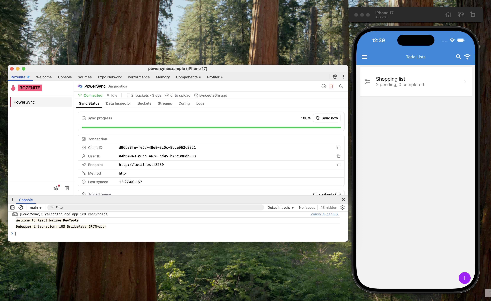

React Native has its own DevTools, which Metro serves. [Rozenite](https://www.rozenite.dev/) is a plugin framework for React Native DevTools. `@powersync/diagnostics` includes a Rozenite plugin that adds a **PowerSync** panel to React Native DevTools. It works with Expo and with bare React Native apps.

Production builds do not include DevTools. In a production build, `usePowerSyncDevTools()` is an empty function, so your app bundle contains no panel, Rozenite, or agent tool code.

## Requirements

- React Native 0.76 or later.
- Rozenite 2.5.0 or later.
- `@powersync/diagnostics` 0.1.0 or later.

{/* TODO: Confirm the @powersync/diagnostics version on the Version Packages PR (expected 0.1.0). */}

## Set Up DevTools

<Steps>
  <Step title="Install the packages">
    ```bash
    npm install -D @powersync/diagnostics @rozenite/metro @rozenite/plugin-bridge @rozenite/agent-bridge
    ```

    Add the packages to the dev dependencies in your app's own `package.json`. Rozenite looks for plugins only in the packages listed there. In a monorepo, it does not find `@powersync/diagnostics` if only a shared package lists it.
  </Step>
  <Step title="Enable Rozenite in Metro">
    In `metro.config.js`, wrap your Metro configuration with `withRozenite()`:

    <Tabs>
      <Tab title="Expo">
        ```javascript
        const { getDefaultConfig } = require('expo/metro-config');
        const { withRozenite } = require('@rozenite/metro');
        
        module.exports = withRozenite(getDefaultConfig(__dirname), {
          enabled: process.env.WITH_ROZENITE === 'true',
          projectType: 'expo'
        });
        ```
      </Tab>
      <Tab title="Bare React Native">
        ```javascript
        const { getDefaultConfig, mergeConfig } = require('@react-native/metro-config');
        const { withRozenite } = require('@rozenite/metro');
        
        const config = {};
        
        module.exports = withRozenite(mergeConfig(getDefaultConfig(__dirname), config), {
          enabled: process.env.WITH_ROZENITE === 'true'
        });
        ```
      </Tab>
    </Tabs>

    With `enabled` set from the `WITH_ROZENITE` environment variable, Rozenite runs only when you start Metro with `WITH_ROZENITE=true`.

    <Warning>
      Rozenite detects an Expo project only from an `app.json` file. If your Expo app uses `app.config.ts` or `app.config.js`, you must set `projectType: 'expo'`. Without it, React Native DevTools opens without the Rozenite tab.
    </Warning>
  </Step>
  <Step title="Add the hook to your app">
    Call `usePowerSyncDevTools()` once, in a component that stays mounted while you debug, such as your root layout:

    ```tsx
    import { usePowerSyncDevTools } from '@powersync/diagnostics/react-native';
    
    export default function RootLayout() {
      // `db` is your PowerSyncDatabase instance.
      usePowerSyncDevTools(db);
      // ...
    }
    ```

    If your app creates the database later, pass `null` until the database exists. DevTools attaches when the hook receives the database.

    DevTools shows only the database that you pass to the hook. If the component unmounts, DevTools loses the connection to the database until the component mounts again.
  </Step>
  <Step title="Optional: Enable diagnostics when you connect">
    To show the total number of operations for each bucket in the **Buckets** tab, set `diagnostics` when you connect:

    ```typescript
    await db.connect(connector, { diagnostics: __DEV__ });
    ```

    The totals require `@powersync/react-native` 2.4.1 or later.

    {/* TODO: Confirm the @powersync/react-native version on the Version Packages PR (expected 2.4.1). */}
  </Step>
  <Step title="Start the app with Rozenite">
    <Tabs>
      <Tab title="Expo">
        ```bash
        WITH_ROZENITE=true npx expo run:ios
        ```

        Use `run:android` for Android, or `npx expo start` if your app is already installed.
      </Tab>
      <Tab title="Bare React Native">
        ```bash
        WITH_ROZENITE=true npx react-native start
        ```

        Then run the app with `npx react-native run-ios` or `npx react-native run-android`.
      </Tab>
    </Tabs>

    In the Android emulator, `localhost` is the emulator, not your computer. If the app connects to a PowerSync Service or backend on `localhost`, forward each port to your computer, for example `adb reverse tcp:8080 tcp:8080`.
  </Step>
  <Step title="Open PowerSync DevTools">
    Open React Native DevTools: press `j` in the Metro terminal, or select **Open DevTools** in the dev menu of your app. Then select the **Rozenite** tab, and select **PowerSync** in its sidebar.
  </Step>
</Steps>

<Frame caption="The PowerSync panel in React Native DevTools, next to the app on the iOS simulator.">
  
</Frame>

To see what each tab shows, read [Using DevTools](/tools/devtools/using-devtools).

## Agent Tools

In React Native apps, coding agents use the [Rozenite agent CLI](https://www.rozenite.dev/docs/agent/overview) instead of an MCP endpoint. The hook registers PowerSync tools that let an agent query the local database of your app, read its sync status, and run sync actions. The tools are in the `powersync/diagnostics` domain, for example `npx rozenite agent powersync/diagnostics status`.

To use the tools, keep the app running with Metro started with `WITH_ROZENITE=true`. The agent runs the commands from your app's folder.

<Tip>
  Give your coding agent a prompt like this one:

  ```text
  My React Native app runs PowerSync DevTools as a Rozenite plugin, and Metro runs with WITH_ROZENITE=true.
  Inspect the app's PowerSync client with the Rozenite agent CLI. Run all commands from the app folder.
  1. Run `npx rozenite skills show core` and `npx rozenite skills show cli` to learn how the CLI works.
  2. Run `npx rozenite agent powersync/diagnostics` to list the PowerSync tools. Add `--help` after a tool name to see its arguments.
  3. Call the `status` and `upload-queue` tools, and tell me the sync state.
  4. When you finish, run `npx rozenite agent session stop`.
  ```

  The agent session holds the app's only debugger connection. Step 4 releases it.
</Tip>

| Tool | Returns |
| --- | --- |
| `query` | The result of a SQL statement against the local database. |
| `schema` | The schema, as the PowerSync SQLite core receives it. |
| `info` | The endpoint, the token, the client ID, the connection method, and the core version. |
| `status` | The last sync status that the client reported. |
| `upload-queue` | The number and size of the local changes that wait to upload. |
| `action` | Runs one of these actions: `reconnect`, `disconnect`, `clearData`, `requestCheckpoint`, `subscribeStream`, `unsubscribeStream`. |

These tools match the [MCP tools](/tools/devtools/mcp#tools) of the other platforms, with these differences:

- Tool names have no `powersync_` prefix.
- Tools take named arguments, such as `--sql`, instead of positional arguments.
- There is no database ID argument and no `sources` tool, because the tools use the database that you pass to the hook.

<Warning>
  `query` can change data. A write to one of your schema tables goes into the upload queue, and your connector uploads it like a write from your app. `action` with `clearData` deletes the local data, including the local changes in the upload queue, and downloads the data again. Give these tools only to agents that you trust.
</Warning>

## Troubleshooting

**React Native DevTools has no Rozenite tab.** Check these causes:

- Metro started without `WITH_ROZENITE=true`.
- Your Expo app uses `app.config.ts` or `app.config.js`, and `projectType: 'expo'` is not set. If `curl http://localhost:8081/json/list` returns a `devtoolsFrontendUrl` that starts with `/debugger-frontend/` instead of `/rozenite/`, Rozenite is not active.

**Changes to `metro.config.js` or new plugins do not appear.** Rozenite loads plugins when Metro starts. Restart Metro. Then close React Native DevTools and open it again, because an open DevTools window keeps the earlier version.

**The PowerSync panel shows no data.** The component that calls `usePowerSyncDevTools()` must be mounted. The panel attaches automatically when the component mounts.
