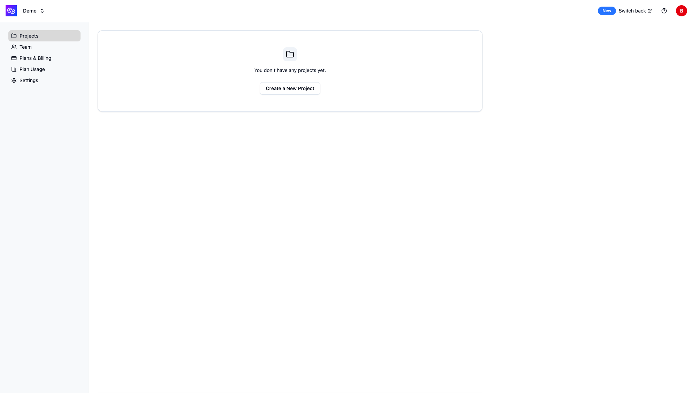
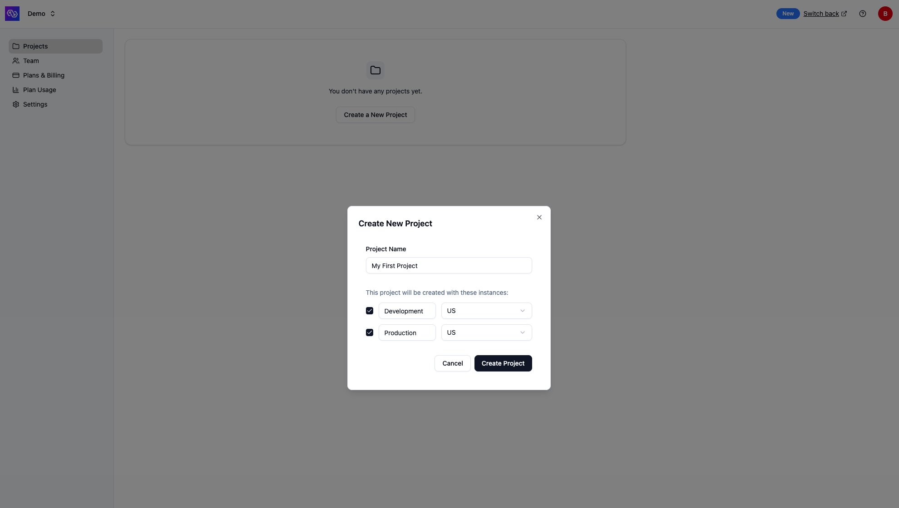
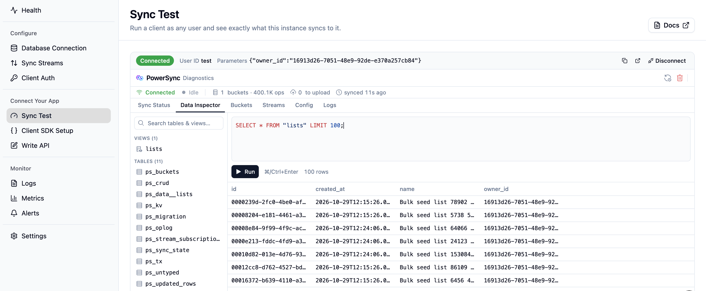
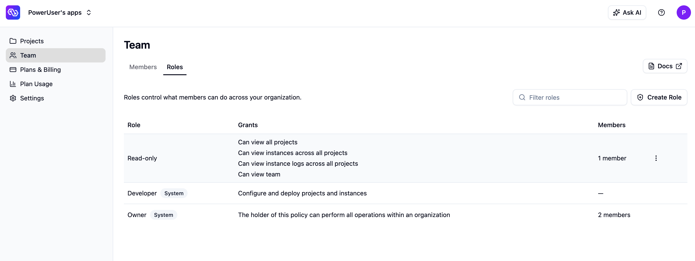
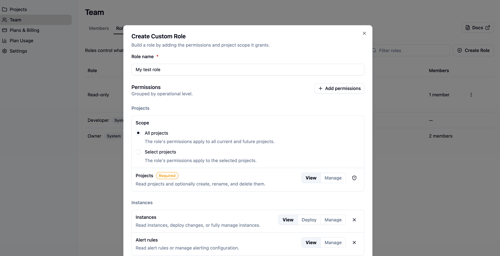
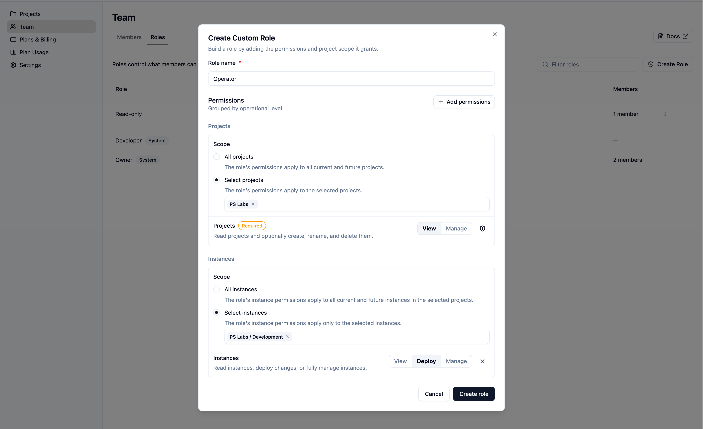

The PowerSync Dashboard is available in [PowerSync Cloud](https://www.powersync.com/pricing) (our cloud-hosted offering) and provides an interface for managing your PowerSync organization, projects, instances, and account settings.

The dashboard is available here: [https://dashboard.powersync.com/](https://dashboard.powersync.com/)

## Hierarchy: Organization, Project, Instance

- After successfully [signing up](https://accounts.powersync.com/portal/powersync-signup?s=docs) for PowerSync Cloud, your **PowerSync account** is created.
- Your account is assigned an **organization** on the [Free pricing plan](https://www.powersync.com/pricing).
- To get started, you'll need to create a **project** in your organization.

<Frame caption="Empty projects view - create your first project">
  
</Frame>

When you click "Create a New Project", you can opt to create a _Development_ and _Production_ **instance** automatically for that project (recommended). An instance runs a copy of the [PowerSync Service](/architecture/powersync-service) and connects to your [backend source database](/configuration/source-db/connection). You can also change the cloud region for each instance. You can't change the region after you create the instance. See [Regions](/configuration/powersync-service/cloud-instances#regions) for details.

<Frame caption="Create new project dialog">
  
</Frame>

Here is an example of how this hierarchy might be used by a customer:

- **Organization**: Wanderlust Inc.
  - **Project**: Wanderlust Tracker
    - **Instance**: Development
    - **Instance**: Production

## Dashboard Overview

The PowerSync Dashboard is organized into three main levels, each providing different functionality:

1. **Organization Level** - Manage projects, team members, organization and billing settings
2. **Account Level** - Manage your personal account settings and access tokens
3. **Project & Instance Level** - Configure and monitor your PowerSync instances

## Organization Level

URL structure: `https://dashboard.powersync.com/org/{orgId}/projects`

At the organization level, you can manage your PowerSync projects and organization-wide settings. Navigate to your organization to access:

- **Projects** - View all projects in your organization, create new projects, and manage project settings
- **Team** - Invite team members to your organization, manage their access with [roles and permissions](#roles-and-permissions), and remove access
- **Plans & Billing** - View or update your PowerSync subscription plan and manage billing details
- **Plan Usage** - Monitor usage metrics across all projects in your organization for the current billing cycle
- **Settings** - Update the organization name

## Account Level

URL structure: `https://dashboard.powersync.com/account/me`

At the account level, you can manage your personal account settings:

- **Account Details** - View your account email and name
- **Security** - Reset your password and configure multi-factor authentication (MFA)
- **Access Tokens** - Create and manage personal access tokens for use with the [CLI](/tools/cli)

## Project & Instance Level

URL structure: `https://dashboard.powersync.com/org/{orgId}/project/{projectId}/{instanceId}/{view}`

When you navigate to a specific instance, you'll see a left sidebar with various views for configuring and monitoring that instance:

- **Health** - Overview of its connection health, deploy history, replication status, and recently connected clients
- **Database Connection** - Configure the source database connection
- **Client Auth** - Configure authentication settings
- **Sync Streams / Sync Rules** - Edit, validate, and deploy your Sync Config.
- **Sync Test** - Connect a client as any user and inspect what it syncs. See [Sync Test](#sync-test).
- **Client SDK Setup** - Generate the [client-side schema](/intro/setup-guide#define-your-client-side-schema) based on your deployed [Sync Streams](/sync/streams/overview)
- **Write API** - Resources for exposing the write API endpoint
- **Logs** - View replication and service logs, and look up a user's sync connections. See [Instance Logs](/maintenance-ops/monitoring-and-alerting#instance-logs).
- **Metrics** - Monitor usage metrics and performance
- **Settings** - Advanced options such as updating the [Service version](#advanced-service-version-locking), [compacting or defragmenting buckets](/maintenance-ops/compacting-buckets), and options for deprovisioning and destroying your instance

In the top bar, you'll see a "Connect" button that provides quick access to your instance URL and other resources for connecting to your instance.

<Frame caption="Dashboard top navigation bar showing the Connect button">
  
</Frame>

### Common Tasks

Here are some of the most common tasks you'll perform in the dashboard:

- **Edit and deploy Sync Streams** - Select your project and instance and go to the **Sync Streams** view to edit your Sync Config, then click **"Validate"** and **"Deploy"** to deploy
- **Generate development token** - Navigate to the **Client Auth** and ensure the **Development tokens** setting is checked. Click the "Connect" button in the top bar and follow instructions to generate a [development token](/configuration/auth/development-tokens).
- **Test what a user syncs** - Navigate to the **Sync Test** view, enter a user ID, and click **Connect**. See [Sync Test](#sync-test).
- **Copy your instance URL** - Click **Connect** in the top bar and copy the instance URL from the dialog.
- **Generate client-side schema** - Click the **Connect** button in the top bar to generate the [client-side schema](/intro/setup-guide#define-your-client-side-schema) based on your deployed [Sync Streams](/sync/streams/overview) in your preferred language
- **Monitor instance health** - Navigate to the **Health** view to see an overview of your instance status, source database connection, and recent deploys
- **View logs** - Navigate to the **Logs** view to review replication and client sync logs
- **Monitor metrics** - Navigate to the **Metrics** view to track usage metrics

### Sync Test

Use the **Sync Test** view to check what your instance syncs to a specific user. It connects a client in your browser as that user and shows [PowerSync DevTools](/tools/devtools-overview) for that client.

Before you start, check the following:

- You have the **Development Tokens** permission. The Owner and Developer roles include it. See [Roles and Permissions](#roles-and-permissions).
- Development tokens are enabled in the **Client Auth** view.
- A Sync Config is deployed.

To connect a client:

1. Navigate to the **Sync Test** view.
2. Enter the user ID. Your Sync Streams read this value as `auth.user_id()`.
3. If your app passes [connection parameters](/sync/streams/parameters#connection-parameters) to `connect()`, add them.
4. Click **Connect**.

To use the values that a user's app sent, open Sync Test from their sync logs with [Sync As This User](/maintenance-ops/monitoring-and-alerting#sync-as-this-user).

<Frame caption="Sync Test connected as a user, with PowerSync DevTools for the client">
  
</Frame>

The client stores the synced data in your browser. Connecting as a different user or to a different instance starts from an empty database, and signing out of the dashboard deletes the data.

A connection that starts from an empty database downloads all of the user's data, like a new installation does. This counts toward your [data synced](/resources/usage-and-billing/pricing-example#data-synced) usage.

The client signs in with a [development token](/configuration/auth/development-tokens), which contains only the user ID. If your Sync Streams read other claims from the token, the client can sync different data than the user's own devices.

To use a token outside the dashboard, click **Generate Token** instead of **Connect**. You can copy the token or open it in the [Sync Diagnostics Client](/tools/diagnostics-client).

### Advanced: Service Version Locking

Customers on our [Team and Enterprise plans](https://www.powersync.com/pricing) can lock their PowerSync Cloud instances to a specific version of the PowerSync Service. This option is available under your instance settings.

Versions are specified as `major.minor.patch`. When locked, only new `.patch` releases will automatically be applied to the instance.

**Downgrade limitations:** Not all downgrade paths are available automatically. If you need to downgrade to an older version, please [contact our team](/resources/contact-us) for assistance.

## Roles and Permissions

A role is a named set of permissions that controls what a member can see and do in your organization. You assign one or more roles to a member when you invite them, and you can change a member's roles at any time. The **Roles** tab on the **Team** page lists the roles available in your organization. System roles are available on every plan, and creating custom roles requires the [Team or Enterprise plan](https://www.powersync.com/pricing).

<Frame caption="The Roles tab on the Team page, listing system and custom roles with their grants and assigned members">
  
</Frame>

### System Roles

Every organization includes system roles that you can assign but cannot edit or delete:

- **Owner** - Full access to the organization, its projects, instances, team, and billing.
- **Developer** - Configure and deploy projects and instances.

To grant access that differs from the system roles, create a custom role.

### Custom Roles

Custom roles are available on the [Team and Enterprise plans](https://www.powersync.com/pricing).

A custom role is a set of permissions that you choose. Each permission covers one operational area and has one or more access levels. A higher level includes everything the lower level allows.

The access levels are as follows:

- **View** gives read-only access to that area. The member can see it but cannot change anything.
- **Deploy** applies only to Instances. It gives View access plus the ability to deploy changes to an instance, such as updating the Sync Config and database connections. It does not allow creating or deleting instances.
- **Manage** gives full access to that area, including creating, editing, and deleting. For Instances, it also includes deploying changes.

<Frame caption="The custom role builder, showing permission rows with access levels">
  
</Frame>

The table below lists each permission, its available access levels, and what those levels grant.

| Permission | Access levels | What it grants |
| --- | --- | --- |
| Projects | View, Manage | View projects. Manage adds creating, renaming, and deleting projects. |
| Instances | View, Deploy, Manage | View instances. Deploy adds deploying changes such as Sync Config and database connections. Manage adds creating and deleting instances. |
| Instance Logs | View | View instance logs. |
| Development Tokens | Generate | Generate [development tokens](/configuration/auth/development-tokens) from Sync Test and the Connect button. A development token can sync as any user. |
| Alert Rules | View, Manage | View Alert Rules. Manage adds creating, editing, and deleting them. |
| Notification Rules | View, Manage | View Notification Rules. Manage adds creating, editing, deleting, and testing them. |
| Private Endpoints | View, Manage | View Private Endpoints. Manage adds creating, editing, and deleting them. |
| Team | View, Manage | View members. Manage adds inviting and removing members and changing their role assignments. |
| Billing | View, Manage | View billing details and the current plan. Manage adds updating billing and changing the plan. |
| Organization Settings | Manage | Update organization configuration, such as the organization name. |

Not every permission offers all access levels. Each area shows only the levels that apply to it: Instance Logs are read-only (View only), and Organization Settings have no separate read-only view (Manage only).

Some permissions depend on others, because access to the parent area is required to reach the child. Instances, Alert Rules, and Notification Rules require at least View on Projects. Instance Logs and Development Tokens require at least View on Instances. The builder adds the required parent permissions for you when you select a dependent one.

### Scoped permissions

Permissions fall into three scopes. Organization-level permissions that apply across the whole organization. Project-level permissions that can be scoped to all projects or to a specific set of projects. And Instance-level permissions that can be scoped to all instances or to a set of instances within projects.

A project-scoped member is granted their permissions inside the selected projects and has no access outside them. The Manage level on Projects is only available on roles scoped to all projects, since creating and deleting projects is an organization-level action.

When permissions is scoped to one or more projects, the instance scope picker become available to select which instances the member can access.

<Frame caption="Scoped permissions in the custom role builder, showing the project scope picker and instance scope picker">
  
</Frame>

If you need finer-grained control than the current permissions allow, [reach out to us](/resources/contact-us) and describe your use case.
