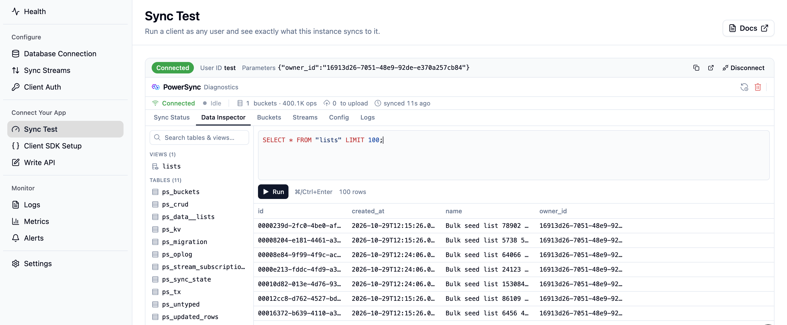

Connect a client as a specific user to check what your Sync Streams sync to them, without running your app. Use this to verify a new setup, to find out why data is missing for a user, or to reproduce what a user synced.

If you're on PowerSync Cloud, use [Sync Test](#sync-test) in the PowerSync Dashboard. If you self-host, use the [Sync Diagnostics Client](#sync-diagnostics-client).

## Sync Test

If you're on PowerSync Cloud, use the **Sync Test** view in the [PowerSync Dashboard](/tools/powersync-dashboard). It connects a client in your browser as a user and shows [PowerSync DevTools](/tools/devtools-overview) for that client. With DevTools you can see:

- The synced tables and rows. You can also run SQL queries against the client-side SQLite database.
- The buckets on the client, with the operations and size of each.
- The user's Sync Stream subscriptions.
- The connection status, download progress, and any download errors.

See [Using DevTools](/tools/devtools/using-devtools) for details on each tab.

<Frame caption="Sync Test connected as a user, with PowerSync DevTools for the client">
  
</Frame>

### Requirements

- You have the **Development Tokens** permission. The Owner and Developer roles include it. See [Roles and Permissions](/tools/powersync-dashboard#roles-and-permissions).
- Development tokens are enabled in the **Client Auth** view.
- A Sync Config is deployed.

### Connect as a User

1. In the [PowerSync Dashboard](https://dashboard.powersync.com/), select your project and instance, and go to the **Sync Test** view.
2. Enter the user ID. Your Sync Streams read this value as `auth.user_id()`.
3. If your app passes [connection parameters](/sync/streams/parameters#connection-parameters) to `connect()`, add them.
4. Click **Connect**.

Sync Test generates a [development token](/configuration/auth/development-tokens) for the user, so you do not need to generate one yourself.

To use the values that a user's app sent, open Sync Test from their sync logs with [Sync As This User](/maintenance-ops/monitoring-and-alerting#sync-as-this-user). It fills in the connection parameters and Sync Stream subscriptions from the logs.

To connect your own app as this user, click **Generate Token** instead of **Connect** and copy the token.

### Good to Know

- The client keeps the synced data in your browser until you sign out of the dashboard. If you connect again as the same user, it downloads only the changes since the last connection. If you connect as a different user or to a different instance, it starts from an empty database and downloads all of the user's data, like a new installation does. Each download counts toward your [data synced](/resources/usage-and-billing/pricing-example#data-synced) usage.
- The client signs in with a development token, which contains only the user ID. If your Sync Streams read other claims from the token, the client can sync different data than the user's own devices. To test with those claims, use the [Sync Diagnostics Client](#sync-diagnostics-client) with a token from your auth provider.

## Sync Diagnostics Client

If you self-host, use the [Sync Diagnostics Client](https://diagnostics-app.powersync.com). It is a web app, built on the PowerSync Web SDK, that connects as a user with a JWT. It shows:

- Summary stats for the user's database, such as the bucket count, total rows, operations, and data size.
- The synced tables, with the row count and size of each.
- The buckets, with the download progress and operation count of each.
- The user's Sync Stream subscriptions.

It also has a SQL console to query the client-side SQLite database.

To connect as a user:

1. Generate a [development token](/configuration/auth/development-tokens) for the user.
2. Open the [Sync Diagnostics Client](https://diagnostics-app.powersync.com).
3. Enter the token at **PowerSync Token**.
4. Enter your PowerSync Service endpoint at **PowerSync Endpoint** unless it is already filled in, for example `http://localhost:8080` if you run the Service locally with Docker.
5. Click **Proceed**.

You can also run the Sync Diagnostics Client locally with Docker. See the [README](https://github.com/powersync-ja/powersync-js/tree/main/tools/diagnostics-app#readme).

## Inspect Your Own App

To inspect the client in your running app, such as its local data, sync status, and logs, use [PowerSync DevTools](/tools/devtools-overview).
